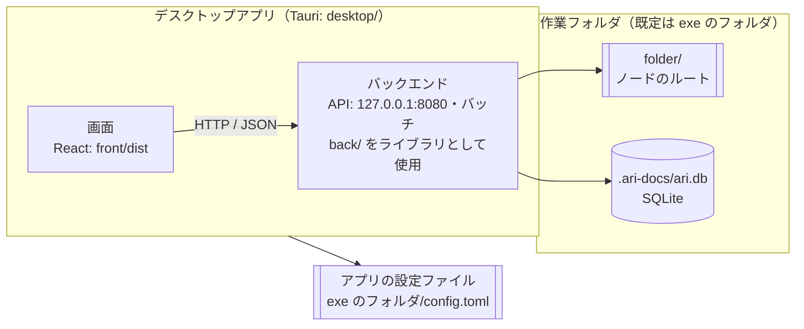

# 0000_システム概要 システム概要

## 1. システム名

ari-docs

## 2. 目的

チームのファイル（フォルダ）・Note・共有ナレッジ（Wiki）を 1 つのアプリでまとめて扱い、目的の情報にすばやくたどり着けるようにする。

### 2.1 製品の方針（2026-11-08）

| 項目 | 方針 |
|---|---|
| 入れ方 | 利用者が自分の PC でインストーラー（exe）を実行して入れる |
| 使い方の選択 | インストールのときに選ぶ。共有サーバーを選んだら、接続できることを確かめてから使う。個人用（ローカル）を選んだら、その PC の中だけで完結させる（外部のサービスへの通信や、外部のソフトのインストールを求めない） |
| 料金 | 当面はすべての機能を無料にする（有料にすると使ってもらえないため） |
| OSS 版 | 個人用と共有サーバーの今の機能。広く使ってもらうため、個人用は入れてすぐ PC の中だけで使えることを優先する |
| Enterprise 版 | 今後、タスク管理などを足す（中身・料金は未定。当面は無料） |

## 3. 利用者

- 個人用: 自分の PC でデスクトップアプリとして使う 1 人の利用者。ログイン操作は不要で、ユーザー `local` として動く（FN0101）
- 共有サーバー: デスクトップアプリから共有サーバーに接続して使う複数の利用者。管理者が登録したユーザー ID とパスワードでログインする（FN0101、FN0102）

## 4. 動作モード

| モード | 設定 | 使い方 | 待ち受け |
|---|---|---|---|
| ローカルモード | `mode = "local"` | デスクトップアプリの「個人用」。バックエンドをアプリと同じプロセスで動かす。ログインなし | `127.0.0.1`（ほかの PC からは接続できない） |
| 共有モード | `mode = "shared"` | サーバー PC でバックエンドだけを動かし（OP0007）、利用者はデスクトップアプリの「共有サーバーに接続」で使う。ログインあり | `bind_address`（既定 `0.0.0.0`） |

デスクトップアプリの使い方は、インストーラー（Windows）か初回起動の画面で選び、設定画面でも変えられる（FN0002）。

## 5. 機能

| ID | 機能 | 概要 |
|---|---|---|
| FN0002 | 作業フォルダ | デスクトップアプリの使い方（個人用 / 共有サーバーに接続）と、ファイルとデータを置くフォルダ（既定は exe と同じフォルダ）の決定と変更 |
| FN0101 | 利用者の識別 | ローカルモードはユーザー `local`、共有モードはログインしたユーザーとして処理する |
| FN0102 | ユーザー管理 | 共有モードのユーザーの登録・削除・パスワードの再設定（管理者） |
| FN0201 | ホーム（検索） | Note・Wiki のキーワード検索と、お気に入りの一覧 |
| FN0301 | フォルダ（ノード）管理 | `folder/` 以下のファイル・フォルダの閲覧・作成・削除・アップロード |
| FN0401 | Note | 個人用の Markdown のメモ |
| FN0501 | Wiki | 共有ナレッジ用の Markdown の文書 |
| FN0601 | お気に入り | ノード・Note・Wiki のお気に入り登録 |
| FN0701 | ユーザー設定 | 表示名と Docs の初期フォルダの変更 |
| FN0801 | Markdown ビューア | 指定フォルダの Markdown を閲覧し、ドキュメントルールに沿ってチェック |
| FN0001 | 共通操作 | ヘッダーによる画面移動とキーボードショートカット |

## 6. システム構成

利用者はデスクトップアプリ（Windows は NSIS のインストーラーで入れる、Linux は AppImage を置く）を起動するだけで使える。バックエンド（API・バッチ）はデスクトップアプリと同じプロセスで動く（FN0002）。

| 構成要素 | 技術 | 場所 |
|---|---|---|
| デスクトップアプリ | Tauri 2 | `desktop/`。画面（`front/dist`）を表示し、バックエンドを同じプロセスで起動する |
| 画面 | React 19 / TypeScript / Vite / Tailwind CSS | `front/` |
| バックエンド | Rust / axum / rusqlite | `back/`（ライブラリ `ari_back`）。`127.0.0.1:8080` で待ち受ける |
| DB | SQLite | `<作業フォルダ>/.ari-docs/ari.db`（起動時にマイグレーションで作成） |
| ノード（ファイル） | ファイルシステム | `<作業フォルダ>/folder/` |
| バッチ | tokio-cron-scheduler（バックエンドと同じプロセス） | `back/src/batch/` |

開発時は、画面を Docker の開発サーバー（`http://localhost:5173`）、バックエンドを `cd back && cargo run` で別々に動かし、ブラウザで使う。このときの設定は `back/config.toml`（OP0001、OP0003）。

## 7. 対象外

- 共有モードの残りの検討事項（HTTPS・セッションの期限・ログイン失敗時のロックなど。RQ0001）
- Note・Wiki の変更履歴の保存
- ノード（ファイル）の内容をアプリ内で編集すること（OS の既定アプリで開く）

## 8. 未決事項

- 権限（`role` テーブル）の使い方（共有モードとあわせて検討する）
- Enterprise 版に入れる機能（タスク管理など）と、OSS 版との分け方（ライセンス・配布物・コードの置き場所）
