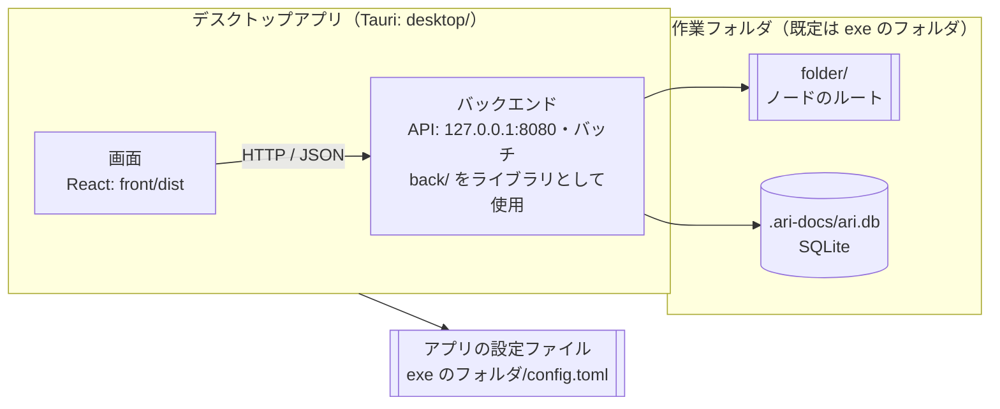

# 0000_システム概要 システム概要

## 1. システム名

ari-docs

## 2. 目的

チームのファイル（フォルダ）・Note・共有ナレッジ（Wiki）を 1 つのアプリでまとめて扱い、目的の情報にすばやくたどり着けるようにする。

### 2.1 製品の方針（2026-11-08）

| 項目 | 方針 |
|---|---|
| 入れ方 | 利用者が自分の PC でインストーラー（exe）を実行して入れる |
| 使い方の選択 | インストールのときに選ぶ。共有サーバーを選んだら、接続できることを確かめてから使う。個人用（ローカル）を選んだら、その PC の中だけで完結させる（外部のサービスへの通信や、外部のソフトのインストールを求めない。新しい版を GitHub で調べるのは、利用者が「更新を確認」を押したときだけ。FN0904-BR04） |
| 料金 | 当面はすべての機能を無料にする（有料にすると使ってもらえないため） |
| 無料版 | 個人用と共有サーバーの今の機能。広く使ってもらうため、個人用は入れてすぐ PC の中だけで使えることを優先する |
| Enterprise 版 | 今後、チームで使う機能（タスクの担当者・依存関係など）を足す（中身・料金は未定。当面は無料）。個人のタスク（FN0602）は無料版に入れた |
| ライセンス | OSS にはしない（2026-11-27）。個人が作って多くの人に無料で使ってもらうフリーソフトとし、個人・会社とも無料で使える。改変・組織の外への再配布・販売は認めない（リポジトリの `LICENSE` の利用規約）。ソースのリポジトリは非公開にし、配布物は公開のリポジトリ `ari-docs-releases` の Releases に載せる（OP0002 の 3.1）。v0.4.0 までの版は配ったときのライセンス（MIT・GNU AGPL v3）のまま |
| クレジット | 作成者・コントリビューター・スポンサーを設定の「クレジット」に出す（FN0903-BR05） |

## 3. 利用者

- 個人用: 自分の PC でデスクトップアプリとして使う 1 人の利用者。ログイン操作は不要で、ユーザー `local` として動く（FN0101）
- 共有サーバー: デスクトップアプリから共有サーバーに接続して使う複数の利用者。管理者が登録したユーザー ID とパスワードでログインする（FN0101、FN0102）

## 4. 動作モード

| モード | 設定 | 使い方 | 待ち受け |
|---|---|---|---|
| ローカルモード | `mode = "local"` | デスクトップアプリの「個人用」。バックエンドをアプリと同じプロセスで動かす。ログインなし | `127.0.0.1`（ほかの PC からは接続できない） |
| 共有モード | `mode = "shared"` | サーバー PC でバックエンドだけを動かし（OP0007）、利用者はデスクトップアプリの「共有サーバーに接続」で使う。ログインあり | `bind_address`（既定 `0.0.0.0`） |

デスクトップアプリの使い方は、インストーラー（Windows）か初回起動の画面で選ぶ。自分の PC（個人用）はいつも使え、共有サーバー（5 つまで）を登録して、ヘッダーで再起動せずに切り替える（場所。FN0002-BR20）。

## 5. 機能

| ID | 機能 | 概要 |
|---|---|---|
| FN0001 | 共通操作 | ヘッダーによる画面移動とキーボードショートカット |
| FN0002 | 作業フォルダ | デスクトップアプリの使い方（個人用 / 共有サーバーに接続）と作業フォルダ（既定は exe と同じフォルダ）の決定と変更 |
| FN0003 | 探して開く | `Ctrl+P` で Note・Wiki・ファイル・フォルダ・画面・操作を名前のあいまい検索で探して開く。最近開いたもの |
| FN0004 | ari-docs のリンク | ファイル・フォルダ・Wiki・Note の場所を `ari://…` の文字で渡し、貼る・押すと ari-docs の中で移る |
| FN0005 | この PC の公開 | 共有 PC のデスクトップアプリを、設定画面から共有サーバーとして公開する（管理者を登録し、今のデータを管理者に移す） |
| FN0101 | 利用者の識別 | ローカルモードはユーザー `local`、共有モードはログインしたユーザーとして処理する |
| FN0102 | ユーザー管理 | 共有モードのユーザーの登録・削除・パスワードの再設定（管理者） |
| FN0201 | ホーム（検索） | ホームの検索（ファイル・フォルダの名前と中身・Note・Wiki。種類・期間で絞る）、お気に入り・やること・最近更新されたもの |
| FN0202 | ファイルの中身の検索 | Excel・Word・PowerPoint・PDF・テキストの中身を単語に区切って登録し、ホームの検索で探す。検索の辞書 |
| FN0301 | フォルダ（ノード）管理 | `folder/` 以下のファイル・フォルダの閲覧と操作（エクスプローラーと同じ操作・プレビュー（Office も）・説明・更新者・ロック・以前の版・新しいウィンドウ） |
| FN0302 | ゴミ箱 | 削除したファイル・フォルダを元に戻す（元のフォルダが無ければ戻す場所を選ぶ）・完全に削除する |
| FN0304 | 比べる | 2 つのファイル（Excel・文字）・フォルダの違いを、WinMerge のように並べて見せる |
| FN0401 | Note | 個人用の Markdown のメモ。ひな形・今日の Note・印刷と書き出し |
| FN0402 | 変更履歴 | Note・Wiki の版を残して前の版に戻す、保存のときの食い違いの確認 |
| FN0403 | Note・Wiki のフォルダ | Note・Wiki をフォルダ（入れ子あり）で分ける・移す |
| FN0404 | Markdown の編集の手助け | 書式のボタン・キー、表の挿入と整形、画像の貼り付け（縮小して保存）、mermaid の図 |
| FN0501 | Wiki | 共有ナレッジ用の Markdown の文書 |
| FN0601 | お気に入り | ノード・Note・Wiki のお気に入り登録 |
| FN0602 | タスク | 個人のタスク（ボード・一覧・WBS・繰り返し・期限の通知） |
| FN0701 | ユーザー設定 | 表示名と Docs の初期フォルダの変更、設定画面の作り、この PC の画面の使い方（表示・拡大・操作・ショートカット・書き出し） |
| FN0702 | Vim モード | Vim・Vimium と同じキーで画面全体を操作し、本文も Vim で編集する。Folder の一覧のファイル操作（yy・x・p・D・cw・V）。キーを変えられる |
| FN0801 | Markdown ビューア | 指定フォルダの Markdown の閲覧とチェック |
| FN0901 | バックアップ | 定期・手動のバックアップと、ダウンロード・復元・削除（管理者） |
| FN0902 | サーバーの設定 | ログイン・保存・アップロードの上限・ファイルのロックと以前の版・Docs を使うかの設定（管理者） |
| FN0903 | アプリの情報 | バージョン・データの量・置き場所の表示とコピー、クレジットとライセンス |
| FN0904 | アプリの更新 | デスクトップアプリが新しい版を共有サーバーか GitHub Releases から取ってきて入れ替える |

## 6. システム構成

利用者はデスクトップアプリ（Windows は NSIS のインストーラーで入れる、Linux は AppImage を置く）を起動するだけで使える。バックエンド（API・バッチ）はデスクトップアプリと同じプロセスで動く（FN0002）。

| 構成要素 | 技術 | 場所 |
|---|---|---|
| デスクトップアプリ | Tauri 2 | `desktop/`。画面（`front/dist`）を表示し、バックエンドを同じプロセスで起動する |
| 画面 | React 19 / TypeScript / Vite / Tailwind CSS | `front/` |
| バックエンド | Rust / axum / rusqlite | `back/`（ライブラリ `ari_back`）。`127.0.0.1:8080` で待ち受ける |
| DB | SQLite | `<作業フォルダ>/.ari-docs/ari.db`（起動時にマイグレーションで作成） |
| ノード（ファイル） | ファイルシステム | `<作業フォルダ>/folder/` |
| バッチ | tokio-cron-scheduler（バックエンドと同じプロセス） | `back/src/batch/` |

開発時は、画面を Docker の開発サーバー（`http://localhost:5173`）、バックエンドを `cd back && cargo run` で別々に動かし、ブラウザで使う。このときの設定は `back/config.toml`（OP0001、OP0003）。

## 7. 対象外

- 共有モードの残りの検討事項（RQ0001）
- ノード（ファイル）の内容をアプリ内で編集すること（OS の既定アプリで開く。プレビューは見るだけ）
- フォルダごとに見られる人・書ける人を分けること（フォルダの権限。2026-11-27 のユーザーの判断）
- アプリの中での印刷・PDF の直接の作成（ブラウザに任せる。FN0401-BR18）
- Excel などへの書き出し（タスク・WBS を含む）

## 8. 未決事項

- Enterprise 版に入れる機能（チームのタスク管理など）と、無料版との分け方（Enterprise 版の料金・配布物）
