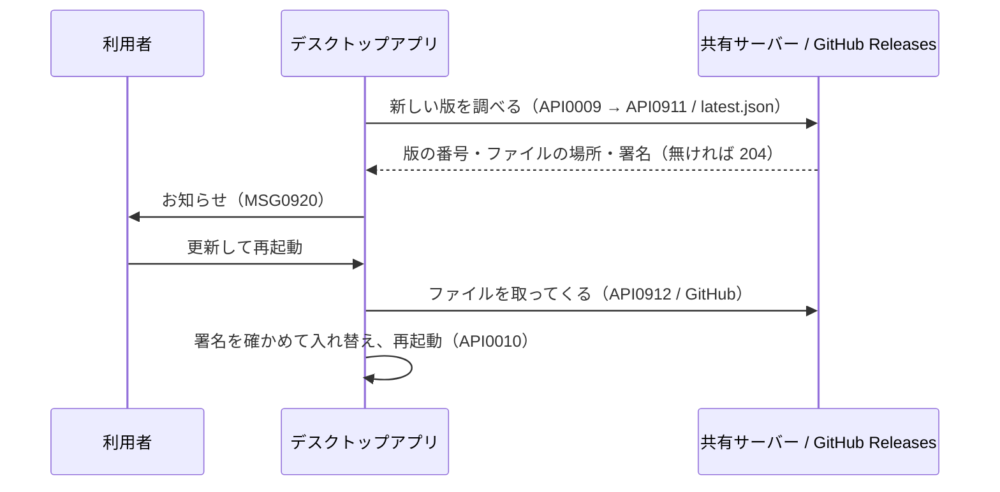

# FN0904 アプリの更新

## 1. 概要

デスクトップアプリが新しい版を調べ、取ってきて入れ替え、再起動する。新しい版は GitHub Releases から取る。共有サーバーにつないでいるときは、そのサーバーと同じ版まで上げる。利用者はインストーラーを探して実行しなくてよい。

Linux の共有サーバーは、管理者が設定の「情報」から新しい版に入れ替える（サーバーの PC を操作しなくてよい）。この PC の公開（FN0005）のサーバーは、アプリの更新でいっしょに新しくなる。

## 2. 対象データ

| データ | 持ち主 | 説明 |
|---|---|---|
| 更新ファイル | 共有サーバーの管理者 | 共有サーバーの `<データのフォルダ>/app-update/` に置く、インストーラーと署名（`.sig`）のファイル（OP0007） |
| GitHub Releases の配布物 | 開発者 | GitHub Actions が作るインストーラー・署名・`latest.json`（OP0002） |
| 署名の鍵 | 開発者 | 秘密鍵は GitHub Actions の Secrets に置く。公開鍵はアプリに入れる（`tauri.conf.json` の `plugins.updater.pubkey`） |

## 3. 権限

| 操作 | 利用者 | 管理者 |
|---|---|---|
| 更新を調べる・更新する（デスクトップアプリ） | ○ | ○ |
| 共有サーバーに更新ファイルを置く | ✕ | ○（サーバーのフォルダにファイルを置く。画面からは置かない） |

## 4. 業務ルール

| ID | ルール | 理由 |
|---|---|---|
| FN0904-BR01 | 更新できるのはデスクトップアプリ（Windows の NSIS・Linux の AppImage）だけとする。ブラウザでは更新の表示を出さない | ブラウザの画面はサーバーが配るため、更新はサーバーの入れ替えで済む |
| FN0904-BR02 | 新しい版の取り先は、今の場所で決める。共有サーバーなら、そのサーバーに置いた更新ファイル（API0911）があればそれを、無ければサーバーと同じ版（`/api/server-info` の `version`）を GitHub Releases の版ごとの `latest.json`（`releases/download/v<版>/latest.json`）から取る。サーバーより新しい版にはしない。自分の PC なら GitHub Releases の最新の `latest.json` | サーバーとアプリの版をそろえるため（新しいアプリが古いサーバーにつながらないように）。管理者がアプリの配布物を置かなくて済むため。GitHub につながらない会社は、サーバーに置く方法を使う |
| FN0904-BR03 | 今の場所が共有サーバーのときは、ログインした後に 1 回、自動で新しい版を調べる。場所を切り替えたとき（画面を読み込み直す）も調べる | 社内ではサーバーに置いた版へそろえたいため |
| FN0904-BR04 | 今の場所が自分の PC のときは、起動したときに調べるかを利用者に一度だけ聞く（お知らせの「知らせる」「知らせない」）。「知らせる」を選んだ PC だけ、起動したときに GitHub を見る。設定の「情報」で変えられ、「更新を確認」はいつでも押せる。選んだものは個人の設定（`updateCheck`。FN0701-BR15） | 個人用は PC の中で完結させ、外へ通信するかを利用者が選ぶため（0000_システム概要 2.1）。インストーラーで入れた人は初回起動の画面を通らないため、お知らせで聞く（2026-11-24 のユーザーの判断） |
| FN0904-BR05 | 新しい版があれば、画面の上にお知らせ（版の番号・「更新して再起動」・「あとで」）を出す。「あとで」を押したら、次に起動するまで出さない | 作業を止めないため |
| FN0904-BR06 | 更新するのは、取ってきたファイルの署名がアプリの公開鍵で確かめられたときだけとする | 共有サーバーや通信の途中でファイルを差し替えられても、入れないため |
| FN0904-BR07 | 共有サーバーからは HTTP でも更新できる | 社内のサーバーは HTTP のことが多い。ファイルの正しさは署名（BR06）で確かめる |
| FN0904-BR08 | 今の版より新しい版だけを入れる（前の版には戻さない） | マイグレーションは進む方向だけで、DB を前の版で開けないため |
| FN0904-BR09 | 更新しても `config.toml`・`folder/`・`.ari-docs/`（DB）は残す | 入れ替えるのはアプリのファイルだけ（OP0002） |
| FN0904-BR10 | 保存していない変更があるときは、更新の前に確認する | 再起動で変更が失われるため |
| FN0904-BR11 | 共有サーバーの更新ファイルは、名前（`ari-docs_<版>_x64-setup.exe`・`ari-docs_<版>_amd64.AppImage`）から版と OS を読み、同じ名前の `.sig` があるものの中で一番新しい版を返す | 管理者が GitHub Releases の配布物をそのまま置くだけで済むため |
| FN0904-BR12 | 開発用のビルド（デバッグビルド）では、調べることはできるが、更新はしない | 開発中の実行ファイルを入れ替えないため |
| FN0904-BR14 | Linux の共有サーバー（`back <config.toml>` で起動したもの）は、管理者（登録した PC。FN0102-BR12）が設定の「情報」の「サーバーの更新」から新しい版に入れ替えられる。デスクトップアプリの中のサーバー（この PC の公開）・開発用のビルド・Linux 以外・署名の鍵の無い版は、画面から更新しない（理由を出す） | 管理者がサーバーの PC（画面の無い Linux）を操作しなくて済むようにするため（2026-11-24 のユーザーの判断）。この PC の公開はアプリと同じプロセスなので、アプリの更新で済む |
| FN0904-BR15 | 管理者がログインしたとき（登録した PC）、GitHub Releases にサーバーの新しい版があれば、お知らせ（「更新の画面を開く」・「あとで」）を出す | 管理者が新しい版に気づけるようにするため |
| FN0904-BR16 | サーバーの更新は、GitHub Releases のサーバー一式（`ari-docs-server_<版>_linux-x86_64.tar.gz`。`back`・文字認識のモデル・ライセンス）を取ってきて、(1) アプリと同じ公開鍵で署名を確かめ、(2) 実行ファイルのフォルダの `.update-new/` に展開し、(3) 新しい `back --version` で版とこのサーバーで動くかを確かめ、(4) DB の写しを `<データのフォルダ>/server-update/ari-<前の版>.db` に作り（前の写しは消す）、(5) モデルと `back` を入れ替えて前のものを `.old` に残し、(6) 同じ引数で起動し直す（プロセスの番号は変わらない）。途中で失敗したら入れ替えたものを戻す。バックアップ・ほかの更新の途中ならしない | 署名で偽物を入れないため。動かない版で止まらないように先に確かめるため。新しい版で困ったとき、前の版と DB に戻せるようにするため（OP0007） |
| FN0904-BR17 | サーバーがインターネットにつながらないときは、管理者が GitHub Releases から落としたサーバー一式と `.sig` を「ファイルから更新」で上げて入れ替えられる（確かめ方は BR16 と同じ） | 社内のネットワークだけのサーバーでも、画面から更新できるようにするため（2026-11-24 のユーザーの判断） |
| FN0904-BR18 | 入れ替える前に、使っている人の操作が切れることを確かめる。入れ替えたら、画面はサーバーが新しい版で答えるまで待ち、読み込み直す（アプリの更新のお知らせが出る。BR02） | 起動し直す間（数十秒ほど）、アップロードなどが失敗するため |
| FN0904-BR19 | 設定の「情報」の「新しい版を自動で調べる」をオフにした PC は、自分の PC・共有サーバーのどちらでも、自分からは新しい版を調べない（BR03・BR04 のお知らせも、管理者へのサーバーの新しい版のお知らせも出さない）。「更新を確認」・「サーバーの更新」の画面を開いたときは調べる。個人の設定（`updateCheck` の `off`） | 今の版のまま使い続けたい人のため（2026-11-24 のユーザーの判断）。共有サーバーでは、アプリがサーバーより古いままになり、新しい機能が動かないことがある |
| FN0904-BR13 | 新しい版が見つかったら、変更点を設定の「情報」に出す。自分の PC は GitHub Releases の本文（自動で作った変更点。`latest.json` の `notes`）、共有サーバーは `app-update/` に置いた `<配布物>.notes.md`（無ければ `notes.md`。64 KB まで）。無ければ出さない | 何が変わるかを見てから更新できるようにするため |

## 5. 処理の流れ

1. 新しい版を調べる（API0009）。共有サーバーなら API0911、自分の PC なら GitHub Releases の `latest.json` を読む。
2. 新しい版があれば、お知らせ（BR05）か設定画面の「情報」に版の番号を出す。
3. 「更新して再起動」を押すと、保存していない変更があれば確認する（BR10）。
4. 更新する（API0010）。ファイルを取ってきて（共有サーバーなら API0912）、署名を確かめ（BR06）、入れ替えて再起動する。取ってくる間は進み具合を出す。
   - Windows: インストーラーを画面を出さずに動かし、アプリは自動で閉じる。入れ終わると新しい版が起動する
   - Linux: `.AppImage` のファイルを入れ替えて再起動する

## 6. メッセージ

| ID | 表示する場面 | 文言 |
|---|---|---|
| MSG0920 | 新しい版がある（お知らせ・情報） | 新しい版（{版}）があります |
| MSG0921 | 新しい版が無い（情報の「更新を確認」） | 今の版が最新です |
| MSG0922 | 調べられなかった | 更新を確認できませんでした。{理由} |
| MSG0923 | 更新できなかった | 更新できませんでした。{理由} |
| MSG0924 | 保存していない変更がある（BR10） | 保存していない変更があります。更新して再起動しますか？ |
| MSG0925 | 取ってきている間 | 新しい版を取ってきています（{割合}%） |

## 7. 関連

| 種類 | ID | 名称 |
|---|---|---|
| 画面 | SCR0001 | 共通レイアウト（更新のお知らせ） |
| 画面 | SCR0701 | 設定（情報の「更新」） |
| API | API0009 | 更新の確認 |
| API | API0010 | 更新の実行 |
| API | API0911 | アプリの更新の情報取得 |
| API | API0912 | アプリの更新ファイルの取得 |
| API | API0913 | サーバーの更新の確認 |
| API | API0914 | サーバーの更新 |
| API | API0915 | ファイルからサーバーの更新 |
| 運用 | OP0002 | ビルド（署名・GitHub Releases） |
| 運用 | OP0007 | 共有サーバーの構築と起動（更新ファイルを置く） |

## 8. 決定事項

| 日付 | 内容 | 理由 |
|---|---|---|
| 2026-11-22 | アプリの中から更新できるようにする（Tauri の updater） | ユーザーの依頼（インストーラーを配らずに更新したい） |
| 2026-11-22 | 取り先は、共有サーバーにつないでいればそのサーバー（自動で調べる）、自分の PC なら GitHub Releases（押したときだけ調べる）とする | 社内で完結させ、サーバーとアプリの版をそろえるため。個人用の「PC の中で完結」の方針を守るため |
| 2026-11-22 | 更新の変更点を画面に出す（FN0904-BR13） | おすすめで決めた（2026-11-28 にユーザーが確認した） |
| 2026-11-24 | アプリは GitHub Releases から取り、共有サーバーにつないでいるときはサーバーと同じ版まで上げる（BR02）。サーバーに置いた更新ファイルは、GitHub につながらない会社のために残す | ユーザーの依頼（新しい版を出したときに、管理者がアプリの配布物を置く手間をなくす） |
| 2026-11-24 | Linux の共有サーバーは管理者が画面から更新する（BR14〜BR18）。つながらないサーバーはファイルを上げて更新する | ユーザーの判断（管理者が ari-docs の操作だけで更新できるように） |
| 2026-11-24 | 「新しい版を自動で調べる」をオフにすれば、共有サーバーでも調べない（BR19） | ユーザーの依頼（確かめすらせず今の版で使い続ける設定がほしい） |
| 2026-11-24 | 自分の PC で起動したときに調べるかは、利用者に一度だけ聞く（BR04） | ユーザーの判断（外へ通信するかを本人が決める） |
| 2026-11-27 | 取り先の GitHub Releases を、ソースのリポジトリから配布用の公開リポジトリ `ari-docs-releases` に変える（v0.5.0 から） | ユーザーの判断（OSS をやめ、ソースを非公開にするため） |

## 9. 未決事項

-

