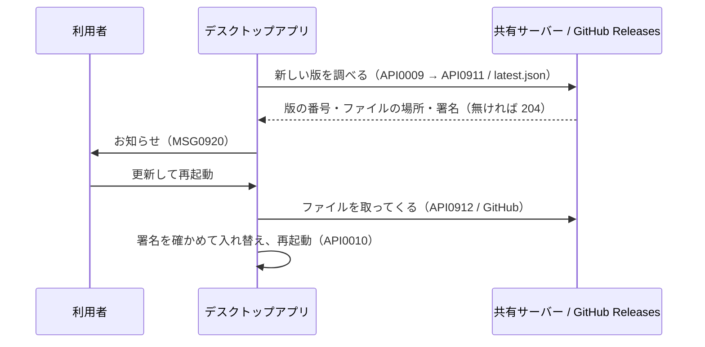

# FN0904 アプリの更新

## 1. 概要

デスクトップアプリが新しい版を調べ、取ってきて入れ替え、再起動する。新しい版は、共有サーバーにつないでいるときはそのサーバーから、自分の PC のときは GitHub Releases から取る。利用者はインストーラーを探して実行しなくてよい。

## 2. 対象データ

| データ | 持ち主 | 説明 |
|---|---|---|
| 更新ファイル | 共有サーバーの管理者 | 共有サーバーの `<データのフォルダ>/app-update/` に置く、インストーラーと署名（`.sig`）のファイル（OP0007） |
| GitHub Releases の配布物 | 開発者 | GitHub Actions が作るインストーラー・署名・`latest.json`（OP0002） |
| 署名の鍵 | 開発者 | 秘密鍵は GitHub Actions の Secrets に置く。公開鍵はアプリに入れる（`tauri.conf.json` の `plugins.updater.pubkey`） |

## 3. 権限

| 操作 | 利用者 | 管理者 |
|---|---|---|
| 更新を調べる・更新する（デスクトップアプリ） | ○ | ○ |
| 共有サーバーに更新ファイルを置く | ✕ | ○（サーバーのフォルダにファイルを置く。画面からは置かない） |

## 4. 業務ルール

| ID | ルール | 理由 |
|---|---|---|
| FN0904-BR01 | 更新できるのはデスクトップアプリ（Windows の NSIS・Linux の AppImage）だけとする。ブラウザでは更新の表示を出さない | ブラウザの画面はサーバーが配るため、更新はサーバーの入れ替えで済む |
| FN0904-BR02 | 新しい版の取り先は、今の場所で決める。共有サーバーならそのサーバー（API0911）、自分の PC なら GitHub Releases の `latest.json` | 社内の利用者は社内のサーバーだけで更新でき、サーバーとアプリの版もそろうため |
| FN0904-BR03 | 今の場所が共有サーバーのときは、ログインした後に 1 回、自動で新しい版を調べる。場所を切り替えたとき（画面を読み込み直す）も調べる | 社内ではサーバーに置いた版へそろえたいため |
| FN0904-BR04 | 今の場所が自分の PC のときは、自動では調べない。設定画面の「情報」の「更新を確認」を押したときだけ GitHub を見る | 個人用は PC の中で完結させ、利用者が選んだときだけ外へ通信するため（0000_システム概要 2.1） |
| FN0904-BR05 | 新しい版があれば、画面の上にお知らせ（版の番号・「更新して再起動」・「あとで」）を出す。「あとで」を押したら、次に起動するまで出さない | 作業を止めないため |
| FN0904-BR06 | 更新するのは、取ってきたファイルの署名がアプリの公開鍵で確かめられたときだけとする | 共有サーバーや通信の途中でファイルを差し替えられても、入れないため |
| FN0904-BR07 | 共有サーバーからは HTTP でも更新できる | 社内のサーバーは HTTP のことが多い。ファイルの正しさは署名（BR06）で確かめる |
| FN0904-BR08 | 今の版より新しい版だけを入れる（前の版には戻さない） | マイグレーションは進む方向だけで、DB を前の版で開けないため |
| FN0904-BR09 | 更新しても `config.toml`・`folder/`・`.ari-docs/`（DB）は残す | 入れ替えるのはアプリのファイルだけ（OP0002） |
| FN0904-BR10 | 保存していない変更があるときは、更新の前に確認する | 再起動で変更が失われるため |
| FN0904-BR11 | 共有サーバーの更新ファイルは、名前（`ari-docs_<版>_x64-setup.exe`・`ari-docs_<版>_amd64.AppImage`）から版と OS を読み、同じ名前の `.sig` があるものの中で一番新しい版を返す | 管理者が GitHub Releases の配布物をそのまま置くだけで済むため |
| FN0904-BR12 | 開発用のビルド（デバッグビルド）では、調べることはできるが、更新はしない | 開発中の実行ファイルを入れ替えないため |
| FN0904-BR13 | 新しい版が見つかったら、変更点を設定の「情報」に出す。自分の PC は GitHub Releases の本文（自動で作った変更点。`latest.json` の `notes`）、共有サーバーは `app-update/` に置いた `<配布物>.notes.md`（無ければ `notes.md`。64 KB まで）。無ければ出さない | 何が変わるかを見てから更新できるようにするため |

## 5. 処理の流れ

1. 新しい版を調べる（API0009）。共有サーバーなら API0911、自分の PC なら GitHub Releases の `latest.json` を読む。
2. 新しい版があれば、お知らせ（BR05）か設定画面の「情報」に版の番号を出す。
3. 「更新して再起動」を押すと、保存していない変更があれば確認する（BR10）。
4. 更新する（API0010）。ファイルを取ってきて（共有サーバーなら API0912）、署名を確かめ（BR06）、入れ替えて再起動する。取ってくる間は進み具合を出す。
   - Windows: インストーラーを画面を出さずに動かし、アプリは自動で閉じる。入れ終わると新しい版が起動する
   - Linux: `.AppImage` のファイルを入れ替えて再起動する

## 6. メッセージ

| ID | 表示する場面 | 文言 |
|---|---|---|
| MSG0920 | 新しい版がある（お知らせ・情報） | 新しい版（{版}）があります |
| MSG0921 | 新しい版が無い（情報の「更新を確認」） | 今の版が最新です |
| MSG0922 | 調べられなかった | 更新を確認できませんでした。{理由} |
| MSG0923 | 更新できなかった | 更新できませんでした。{理由} |
| MSG0924 | 保存していない変更がある（BR10） | 保存していない変更があります。更新して再起動しますか？ |
| MSG0925 | 取ってきている間 | 新しい版を取ってきています（{割合}%） |

## 7. 関連

| 種類 | ID | 名称 |
|---|---|---|
| 画面 | SCR0001 | 共通レイアウト（更新のお知らせ） |
| 画面 | SCR0701 | 設定（情報の「更新」） |
| API | API0009 | 更新の確認 |
| API | API0010 | 更新の実行 |
| API | API0911 | アプリの更新の情報取得 |
| API | API0912 | アプリの更新ファイルの取得 |
| 運用 | OP0002 | ビルド（署名・GitHub Releases） |
| 運用 | OP0007 | 共有サーバーの構築と起動（更新ファイルを置く） |

## 8. 決定事項

| 日付 | 内容 | 理由 |
|---|---|---|
| 2026-11-22 | アプリの中から更新できるようにする（Tauri の updater） | ユーザーの依頼（インストーラーを配らずに更新したい） |
| 2026-11-22 | 取り先は、共有サーバーにつないでいればそのサーバー（自動で調べる）、自分の PC なら GitHub Releases（押したときだけ調べる）とする | 社内で完結させ、サーバーとアプリの版をそろえるため。個人用の「PC の中で完結」の方針を守るため |
| 2026-11-22 | 更新の変更点を画面に出す（FN0904-BR13） | おすすめで決めた（ユーザーの確認待ち） |

## 9. 未決事項

-

