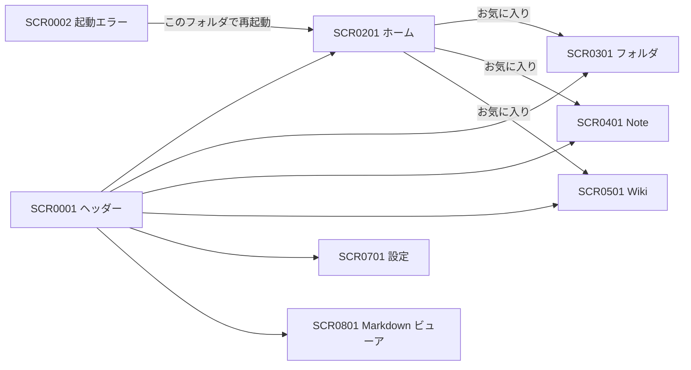

# 0000_画面一覧 画面一覧

フロントエンド（`front/src/routes/index.tsx`）の画面。ログイン画面（SCR0004）は共有モードだけで使う。

| ID | 名称 | URL | 機能 | 概要 |
|---|---|---|---|---|
| [SCR0001](SCR0001_共通レイアウト.md) | 共通レイアウト（ヘッダー） | （全画面の上部） | FN0001, FN0003 | 画面の移動・探して開く |
| [SCR0002](SCR0002_起動エラー.md) | 起動エラー | （デスクトップアプリでバックエンドを起動できなかったとき） | FN0002 | 起動できなかった原因の表示と、作業フォルダの選び直し |
| [SCR0003](SCR0003_初回起動.md) | 初回起動 | （デスクトップアプリで `config.toml` が無いとき） | FN0002 | 使い方（個人用 / 共有サーバーに接続）の選択 |
| [SCR0004](SCR0004_ログイン.md) | ログイン | （共有モードで未ログインのとき） | FN0101, FN0102 | ログイン、最初の管理者の登録、接続エラーの表示 |
| [SCR0201](SCR0201_ホーム.md) | ホーム | `/` | FN0201, FN0601 | Note・Wiki の検索と、お気に入りからの移動 |
| [SCR0301](SCR0301_フォルダ.md) | フォルダ | `/folder` | FN0301, FN0601 | `folder/` 以下のノードの閲覧と操作 |
| [SCR0401](SCR0401_Note.md) | Note | `/note` | FN0401, FN0601 | Note の一覧・編集 |
| [SCR0501](SCR0501_Wiki.md) | Wiki | `/wiki` | FN0501, FN0601 | Wiki の一覧・編集 |
| [SCR0701](SCR0701_設定.md) | 設定 | `/setting` | FN0701, FN0002, FN0102 | 表示名・パスワード・Docs の初期フォルダ・ユーザー管理・使い方・作業フォルダの変更 |
| [SCR0801](SCR0801_Markdownビューア.md) | Markdown ビューア | `/docs?root=<フォルダ>&path=<文書>` | FN0801 | 指定フォルダの Markdown の閲覧とチェック |

## 画面遷移

