# はじめに

## ari-docs でできること

ari-docs（アリドックス）は、仕事のファイルとメモを 1 つのアプリでまとめて扱うためのアプリです。

| できること | 画面 | 内容 |
|---|---|---|
| 探す | Home | ファイルの名前だけでなく、Excel・Word・PowerPoint・PDF の**中身**まで探せます。Note・Wiki も一緒に探します |
| ファイルを扱う | Folder | エクスプローラーと同じ操作で、ファイル・フォルダを開く・移す・コピーする・消す。中身をアプリの中でのぞけます |
| 書き留める | Note | 自分だけのメモ。議事録・日報などのひな形から書き始められます |
| みんなで共有する | Wiki | 手順書・決まりごとなど、全員で読む・直す文書 |
| やることを管理する | Task | 自分のタスクをボード・一覧・WBS（日程の表）で管理します |

ari-docs の使い方は 2 通りあります。どちらで使うかは、導入した担当の方が決めています。

| 使い方 | 内容 |
|---|---|
| 自分の PC（個人用） | データはこの PC の中だけに置きます。ログインは要りません |
| 共有サーバー | 職場のサーバーにつなぎ、ファイル・Wiki をみんなで使います。ユーザー ID とパスワードでログインします |

::: note
Note とタスクは、共有サーバーで使っていても**本人だけ**が見られます。Wiki と Folder のファイルは、そのサーバーを使う全員が見られます。
:::

## 画面の見方

画面の上の帯（ヘッダー）で、使う画面を切り替えます。

::: shot
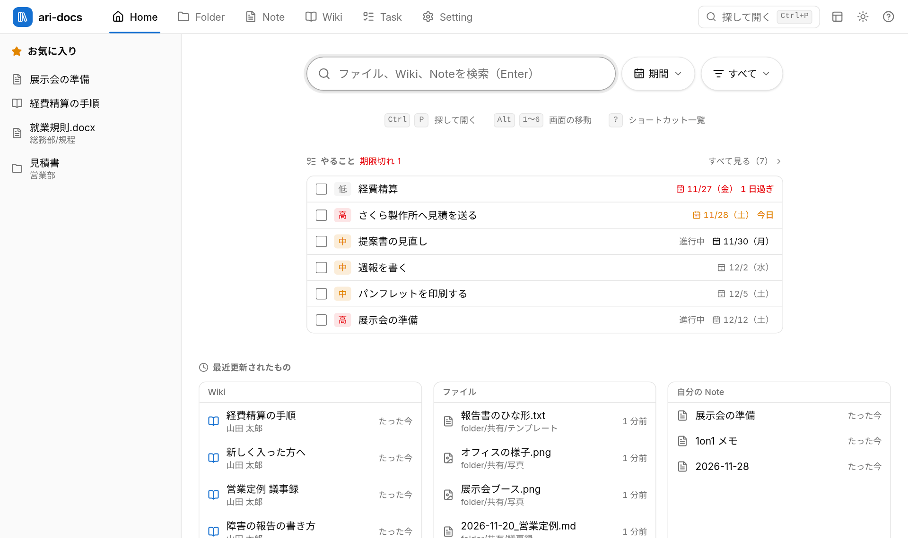

[ホームの画面。上の帯で画面を切り替える]{.caption}
:::

| ヘッダーの部品 | 内容 |
|---|---|
| Home・Folder・Note・Wiki・Task・Setting | 押すとその画面へ移ります。<kbd>Alt</kbd>+<kbd>1</kbd>〜<kbd>6</kbd> でも移れます（左から順に 1・2・3…） |
| 探して開く | 名前の一部を打つだけで、Note・Wiki・ファイル・画面を開けます（<kbd>Ctrl</kbd>+<kbd>P</kbd>） |
| 場所 | 共有サーバーを登録しているときだけ出ます。自分の PC と共有サーバーを切り替えます（<kbd>Alt</kbd>+<kbd>0</kbd>） |
| ⧉ | 今の画面を新しいウィンドウで開きます |
| ☀ | 明るい配色・暗い配色を切り替えます |
| ? | キーの操作（ショートカット）の一覧を出します。<kbd>?</kbd> キーでも開きます |

::: point
ボタンにマウスを乗せて少し待つと、そのボタンの説明が出ます。迷ったときは乗せてみてください。
:::

# 使い始める

## 入れる

インストールのしかたは、導入の担当の方の案内に従ってください。一般的な流れは次のとおりです。

1. 担当の方に案内された場所から、インストーラー（`ari-docs_<版>_x64-setup.exe`）を取ってきて開きます。
2. 「Windows によって PC が保護されました」と出たら、「詳細情報」を押してから「実行」を押します。
3. 利用規約を読み、同意して進みます。
4. 使い方を選びます。
   - 個人用: 「個人用（この PC だけで使う）」を選びます。
   - 共有サーバー: 「共有サーバーに接続する」を選び、担当の方から聞いたサーバーの URL（例: `http://ari-server:8080`）を入れます。
5. 終わったら、スタートメニューの「ari-docs」から起動します。

## ログインする（共有サーバー）

共有サーバーにつなぐと、ログインの画面が出ます。担当の方から聞いたユーザー ID とパスワードを入れてください。

- 一度ログインすると、しばらく（既定では 30 日）使わない日が続くまでログインしたままになります。
- パスワードを続けて間違えると、しばらく（既定では 15 分）ログインできなくなります。
- 初めのパスワードは、ログインしたあと設定の「パスワードとログイン」で自分のものに変えてください。

## 場所を切り替える

自分の PC と共有サーバーの両方を使うときは、ヘッダーの「場所」で切り替えます（アプリの再起動は要りません）。共有サーバーは設定の「場所」で 5 つまで登録できます。

::: note
データ・ログイン・最近開いたものは場所ごとに別です。検索も今の場所の中だけを探します。
:::

# 探す（Home）

## 検索する

ホームの検索欄に言葉を入れて <kbd>Enter</kbd> を押すと、次のものをまとめて探します。

- ファイル・フォルダの名前と説明
- ファイルの**中身**（Excel・Word・PowerPoint・PDF・テキストなど。画像や、文字の無い PDF の中の文字も読み取ります）
- Note・Wiki のタイトルと本文

::: shot
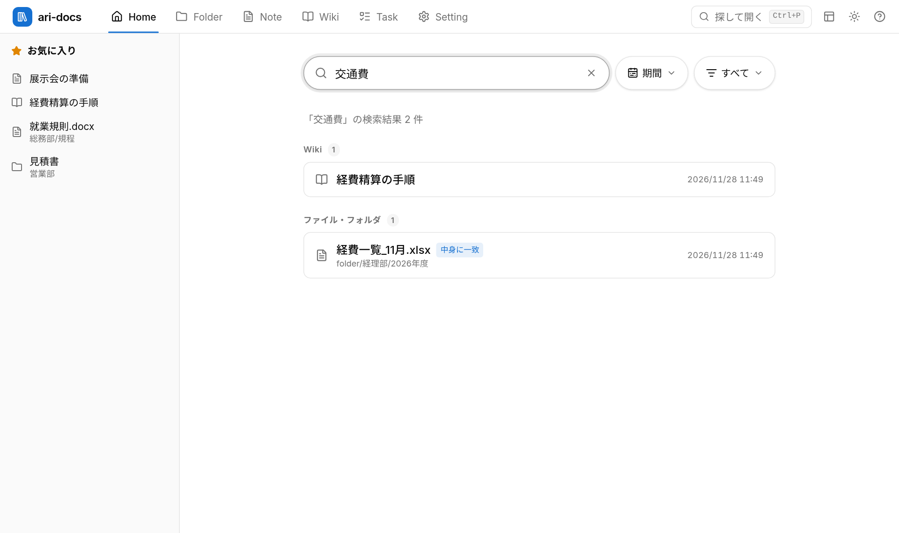

[検索の結果。種類ごとにまとめて出る]{.caption}
:::

| 絞り込み | 使い方 |
|---|---|
| 探す種類 | 検索欄の右のボタンで、Excel・Word・PDF・画像・Note・Wiki などを選べます（いくつでも） |
| 名前だけで探す | 同じボタンの「ファイル名・フォルダ名だけで探す」をオンにすると、中身を探さずに速く探せます |
| 期間 | 「期間」で更新日を絞れます（今日・1 週間以内・1 か月以内など）。言葉を入れなくても、期間だけで探せます |
| ファイルの場所 | 結果が複数のフォルダにまたがるときは、フォルダで絞れます |

::: note
置いたばかりのファイルの中身は、検索できるようになるまで数分かかります。業界の言葉・社内の言葉がうまく探せないときは、設定の「検索の辞書」に言葉を登録すると見つかるようになります（共有サーバーでは、登録できるのは管理者と許可を付けた人です）。
:::

## ホームに並ぶもの

| 欄 | 内容 |
|---|---|
| お気に入り（左） | ★を付けたファイル・フォルダ・Note・Wiki。ドラッグか <kbd>Alt</kbd>+<kbd>↑</kbd><kbd>↓</kbd> で並べ替えられます |
| やること | 期限の近いタスク・期限を過ぎたタスク・進めているタスク。チェックで完了にできます |
| 最近更新されたもの | Wiki・ファイル・自分の Note のうち、最近変わったもの |

## 探して開く（Ctrl+P）

どの画面からでも <kbd>Ctrl</kbd>+<kbd>P</kbd> を押すと「探して開く」が開きます。名前の一部を打つと候補が出るので、<kbd>↑</kbd><kbd>↓</kbd> で選んで <kbd>Enter</kbd> で開きます。

::: shot
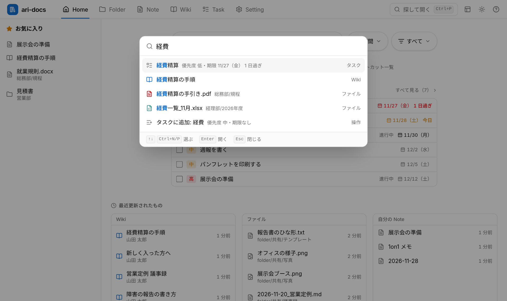

[探して開く。打つ前は最近開いたものが並ぶ]{.caption}
:::

- 「議録」と打てば「議事録」が出るように、文字が飛び飛びでも見つかります。
- 画面（「設定」など）や操作（「今日の Note を開く」「新しいタスクを作る」など）も開けます。
- 打った言葉で見つからないときは、一番下の「タスクに追加」でそのままタスクにできます。

# ファイルとフォルダ（Folder）

## 一覧の見方

Folder の画面は、左にフォルダの木、真ん中に一覧、右にプレビュー（中身の表示）が並びます。

::: shot
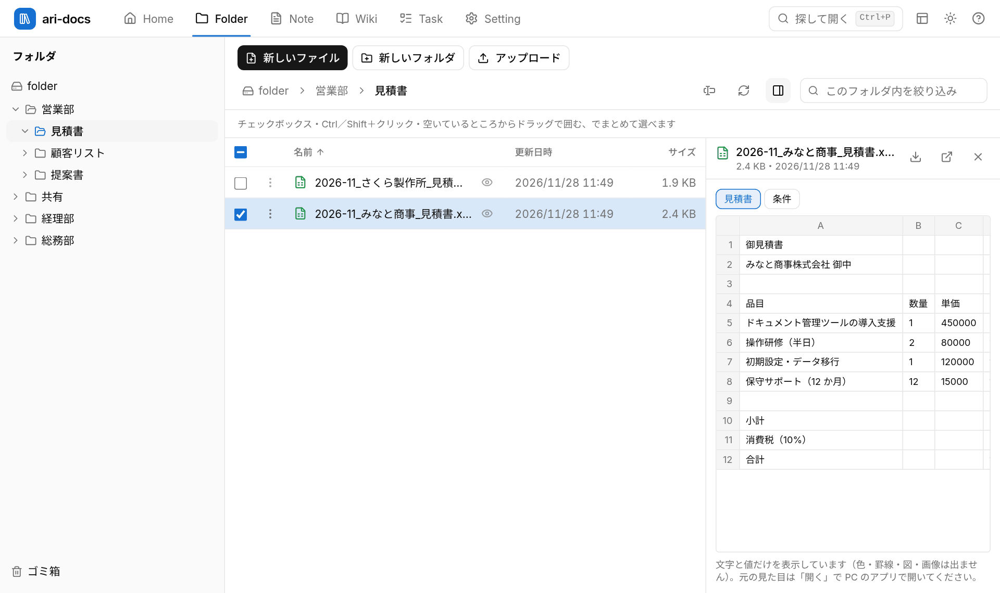

[Folder の画面。右に選んだファイルの中身が出る]{.caption}
:::

| 一覧の列 | 内容 |
|---|---|
| 名前 | ★はお気に入り、👁 はプレビューできるファイル、🔒 はほかの人がロックしているファイル |
| 説明 | ファイルの一言の説明（だれでも書けます） |
| 更新者 | 共有サーバーで、ari-docs で最後に変えた人 |
| 更新日時・サイズ | - |

見出しを押すと、その列で並べ替えます。右のプレビューは <kbd>Alt</kbd>+<kbd>P</kbd> で出し入れできます。

## 開く

- フォルダはダブルクリック（か <kbd>Enter</kbd>）で中へ入ります。上の階層へは <kbd>Alt</kbd>+<kbd>↑</kbd> か <kbd>Backspace</kbd> で戻ります。
- ファイルはダブルクリックで、PC のアプリ（Excel など）で開きます。
- 共有サーバーのファイルは、PC に取ってきてから開きます。開いたファイルを保存すると、**自動でサーバーに戻します**（開いてから 24 時間、アプリを開いている間）。
- パンくず（上の `folder > 営業部 > …`）の空いているところを押すか <kbd>Ctrl</kbd>+<kbd>L</kbd> で、場所を打って移れます。

::: warning
安全のため、共有サーバーの実行するファイル（`.exe`・`.bat` など）はアプリから直接は開きません。ダウンロードはできます。
:::

## 中身をのぞく（プレビュー）

ファイルを選ぶと右に中身が出ます。<kbd>Space</kbd> で大きく開くこともできます。

| 形式 | 表示 |
|---|---|
| 画像・PDF | そのまま |
| Excel | シートのタブ・列名（A・B…）・行番号の付いた表で、セルの値 |
| Word・PowerPoint | 文章（表は行ごと）・スライドごとの文字 |
| テキスト・CSV・Markdown | 文字・表・整えた文章（大きいものは先頭だけ） |

::: shot
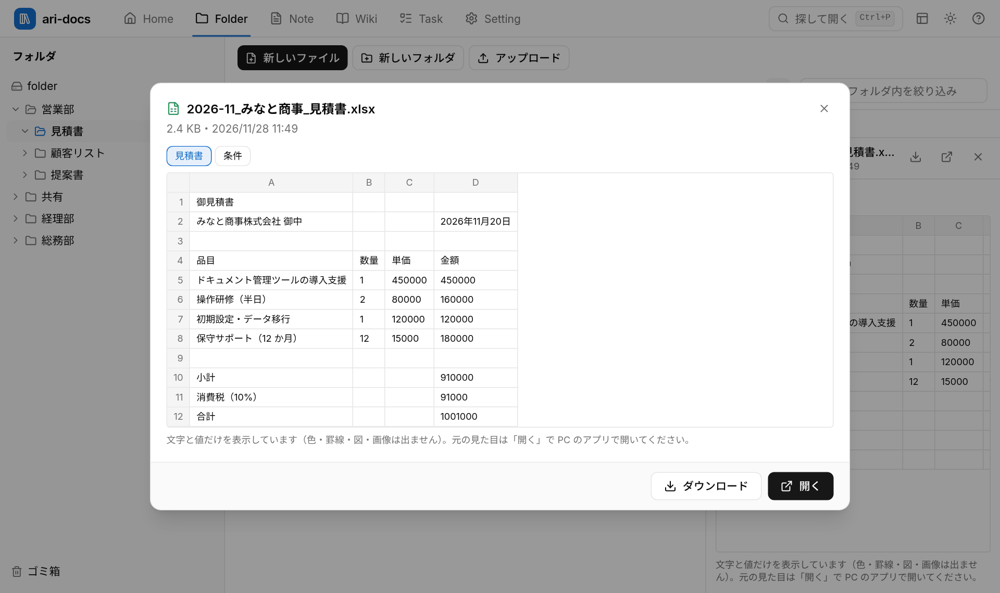

[Excel のプレビュー。値だけを素早く確かめられる]{.caption}
:::

::: note
Excel・Word・PowerPoint のプレビューは文字と値だけです（色・罫線・図・画像は出ません）。元の見た目は「開く」で確かめてください。
:::

## 作る・アップロードする

- 上の「新しいファイル」「新しいフォルダ」で作ります。
- 「アップロード」か、エクスプローラーから一覧へドラッグしてファイル・フォルダを入れます。同じ名前があれば「置き換える」「両方残す」を選べます。

## 選ぶ・移す・コピーする

エクスプローラーと同じ操作です。

| 操作 | やり方 |
|---|---|
| まとめて選ぶ | <kbd>Ctrl</kbd>・<kbd>Shift</kbd> を押しながらクリック、左端のチェックボックス、空いているところからドラッグして囲む、<kbd>Ctrl</kbd>+<kbd>A</kbd> |
| 移す | 行をフォルダへドラッグ。<kbd>Ctrl</kbd>+<kbd>X</kbd> → <kbd>Ctrl</kbd>+<kbd>V</kbd> |
| コピーする | <kbd>Ctrl</kbd> を押しながらドラッグ。<kbd>Ctrl</kbd>+<kbd>C</kbd> → <kbd>Ctrl</kbd>+<kbd>V</kbd> |
| 名前を変える | <kbd>F2</kbd> |
| まとめてダウンロード | 選んで上の帯の「ZIP」 |

右クリック（か行の左の ︙）で、そのほかの操作のメニューが出ます。

::: shot
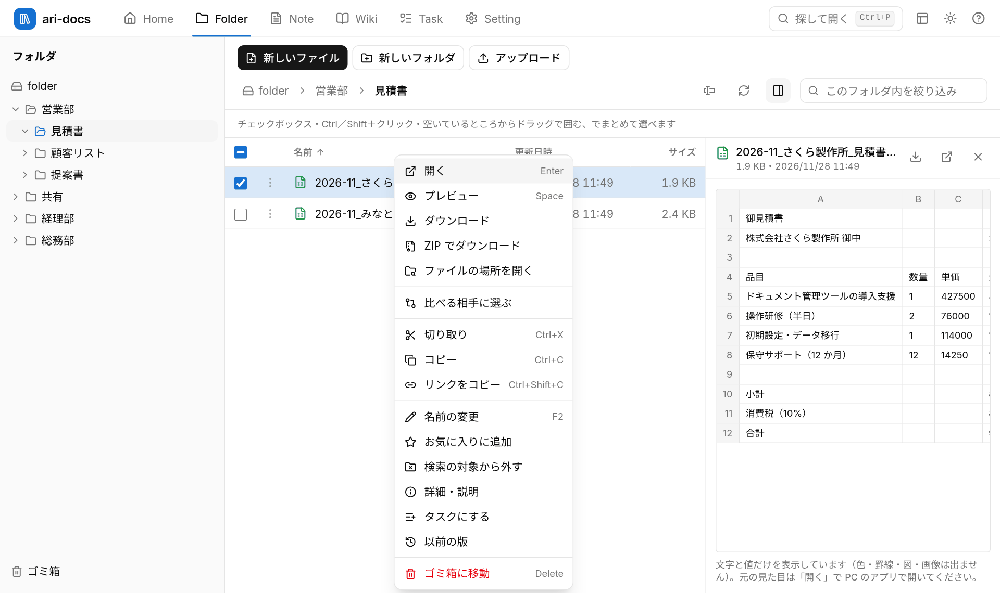

[右クリックのメニュー]{.caption}
:::

| メニュー | 内容 |
|---|---|
| 詳細・説明 | ファイルの説明（200 文字まで）を書きます。説明は検索でも探されます |
| リンクをコピー | `ari://…` のリンクをコピーします。Note・Wiki やチャットに貼ると、押した人が ari-docs でそのファイルを開けます |
| 2 つを比べる | 2 つのファイル（Excel・Word・テキストなど）やフォルダの違いを左右に並べて見せます |
| 以前の版 | ari-docs で上書きする前の中身を見て、取り出す・戻すことができます |
| ロックする | （共有サーバー）期限まで、ほかの人がそのファイルを上書き・移動・削除できないようにします |
| タスクにする | そのファイルを相手にしたタスクを作ります |
| 新しいウィンドウで開く | 別のウィンドウで開きます。ウィンドウどうしでドラッグして移せます |
| 検索の対象から外す | そのフォルダを検索に出さないようにします |

## 消す・ゴミ箱

<kbd>Delete</kbd> を押すと、確かめずにゴミ箱へ移します（すぐには消えません）。ゴミ箱は左の木の一番下にあります。

::: shot
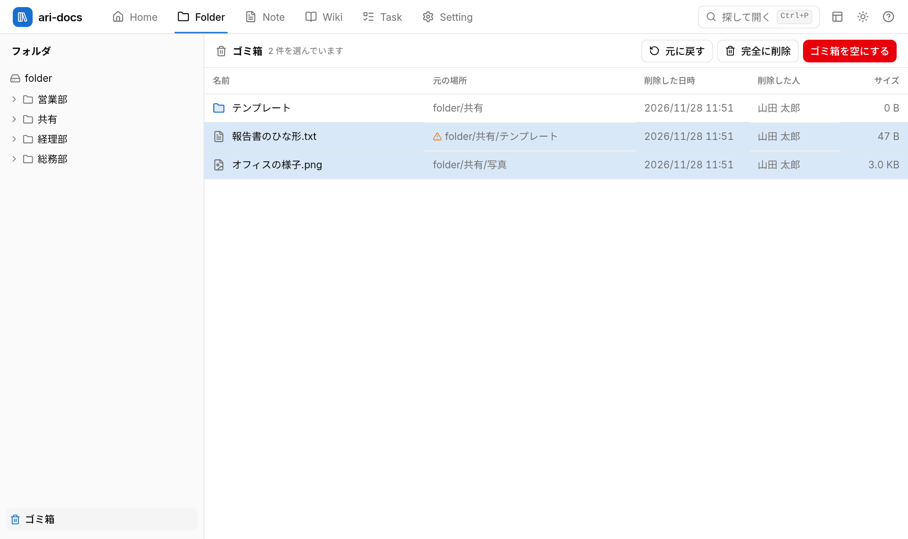

[ゴミ箱。元に戻す・完全に削除ができる]{.caption}
:::

- ゴミ箱でも、左端のチェックボックスや <kbd>Ctrl</kbd>・<kbd>Shift</kbd>+クリックでまとめて選べます。
- ゴミ箱の中のものは、選んで「元に戻す」（ダブルクリック・<kbd>Enter</kbd>）で元の場所に戻ります。
- 元のフォルダが無くなっているものは、元のフォルダを作り直すか、ほかのフォルダを選んで戻せます（⚠ の印が付いています）。
- ゴミ箱のものは、決まった日数（既定は 30 日）がたつと自動で消えます。
- 「完全に削除」したものは元に戻せません。

::: point
消す前に確かめたいときは、設定の「操作」で「削除の前に確かめる」をオンにしてください。
:::

# Note と Wiki

## Note と Wiki の違い

| | Note | Wiki |
|---|---|---|
| 見られる人 | 自分だけ | 全員 |
| 向いているもの | 自分のメモ・日報・下書き | 手順書・決まりごと・議事録の共有 |
| 書き方 | 同じ（Markdown） | 同じ |

## 作る

一覧の上の「＋」（か <kbd>Ctrl</kbd>+<kbd>N</kbd>）で作ります。作るときに**ひな形**を選ぶと、見出しなどが入った状態から書き始められます。

::: shot
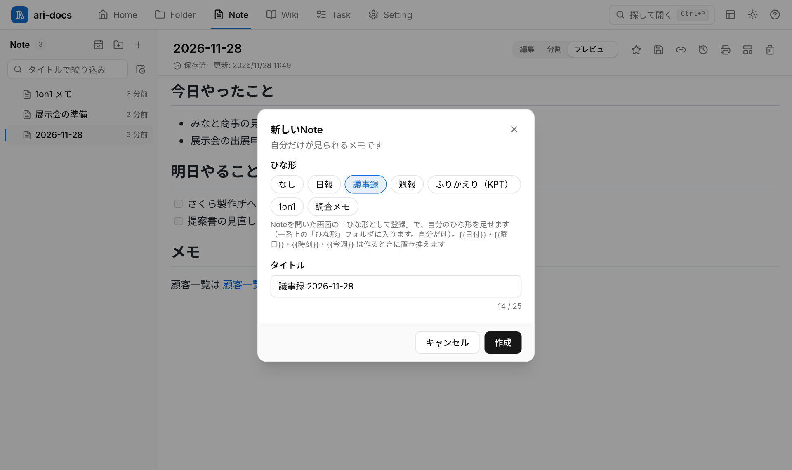

[作るときにひな形を選べる]{.caption}
:::

| 入っているひな形 | Note | Wiki |
|---|---|---|
| 日報・週報・議事録 | ○ | 議事録 |
| ふりかえり（よかったこと・困ったこと・次に試すこと） | ○ | - |
| 1on1・調査メモ | ○ | - |
| 手順書・障害の報告・設計メモ・引き継ぎ | - | ○ |

- 一覧の上の日付のボタンで「今日の Note」（タイトルが今日の日付の Note）を開けます。日報に便利です。
- よく使う形は、自分で作った Note・Wiki を開いて「ひな形として登録」のボタンを押すと、次から選べるようになります。Wiki のひな形は全員が使えます。

## 書く

本文は Markdown（マークダウン）という書き方で書きます。覚えなくても、上の書式のボタンで太字・見出し・箇条書き・表などを入れられます。

::: shot
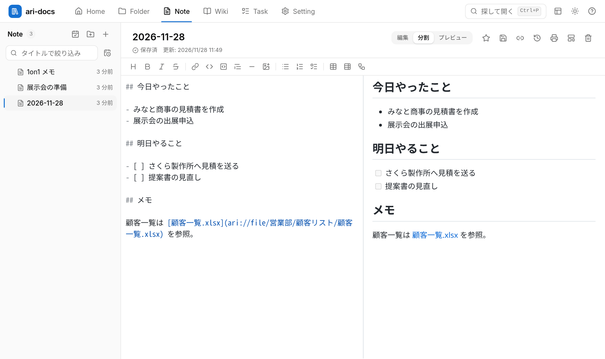

[左で書き、右で仕上がりを見ながら書ける（分割の表示）]{.caption}
:::

| 書きたいもの | ボタン・キー | Markdown の書き方 |
|---|---|---|
| 見出し | 見出し | `## 見出し` |
| 太字 | 太字・<kbd>Ctrl</kbd>+<kbd>B</kbd> | `**太字**` |
| 箇条書き | 箇条書き | `- 項目` |
| チェックリスト | チェックリスト | `- [ ] やること` |
| 表 | 表を入れる | `\| 列 \| 列 \|`（「表を整える」で列をそろえます） |
| リンク | リンク・<kbd>Ctrl</kbd>+<kbd>K</kbd> | `[名前](URL)` |
| 画像 | 貼り付け・ドロップ | 画像を貼り付けると、自動で小さくして入ります |
| 図 | 図 | 流れ図・ガントチャートなどのひな形が入ります |

- 表示は「編集」「分割」「プレビュー」で切り替えます。
- 保存は「保存」のボタンか <kbd>Ctrl</kbd>+<kbd>S</kbd> です。保存していない間は「● 未保存」と出ます。
- 画像は、仕上がりの画像を右クリックして大きさ（小・中・大）を選べます。

## 図を入れる

書式のボタンの「図」から種類を選ぶと、図のひな形が入ります。文字を書き換えると図も変わります。

::: shot
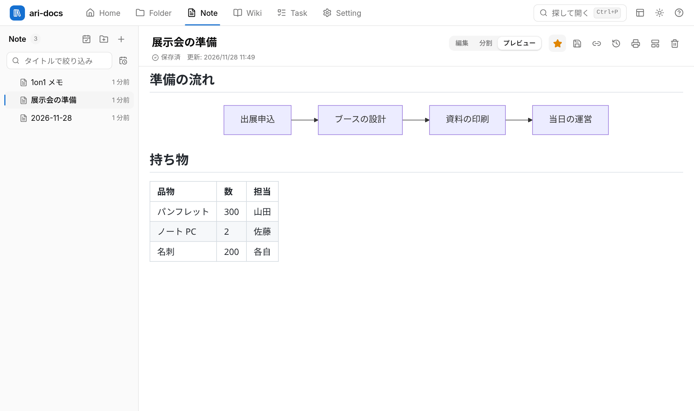

[流れ図の例。文字で書いたものが図になる]{.caption}
:::

| 図の種類 | 向いているもの |
|---|---|
| 流れ図 | 仕事の流れ・手順・分かれ道 |
| シーケンス図 | 人やシステムの間のやり取りの順番 |
| マインドマップ | 考えを広げる・整理する |
| ER 図 | 表とその関係 |
| ガントチャート | 予定の線表 |
| 状態遷移図 | 状態と、その移り変わり |

## 変更履歴

保存するたびに前の版が残ります（既定で 100 版まで）。「変更履歴」のボタンで版の一覧を開き、「前の版との違い」を見たり、前の版に戻したりできます。

共有サーバーの Wiki で、ほかの人が同じ Wiki を書いているときは、開いたときから本文の上にお知らせが出ます。

- 既定では、だれかが書いている間はロックされ、ほかの人は読むだけになります（🔒 のお知らせ）。書いている人が保存すると書けるようになります。止まったままのときは 10 分で自動で外れ、管理者は「ロックを外す」でいつでも外せます。
- 管理者がロックをオフにしているときは、ほかの人も書けます。保存のときにほかの人の保存と重なったら、上書きするかを確かめます。

## 印刷・書き出し

「印刷・書き出し」のボタンから選びます。

| メニュー | 内容 |
|---|---|
| ブラウザで開いて印刷 | ブラウザで開いて印刷の画面を出します。プリンターに「PDF に保存」を選べば PDF にできます |
| HTML のファイルで保存 | 1 つのファイルで開ける形（画像・図も入ります）で保存します。メールで送るときなどに |
| Markdown のファイルで保存 | 本文をそのまま保存します |

## フォルダで分ける

一覧の上の「新しいフォルダ」のボタンでフォルダを作り、Note・Wiki をドラッグで入れます。<kbd>Ctrl</kbd>・<kbd>Shift</kbd> で選んでまとめて移せます。Wiki のフォルダは全員で使います。

# タスク（Task）

## タスクを足す

上の欄にタイトルを入れて <kbd>Enter</kbd> で足します。文の終わりに言葉を付けると、期限・優先度になります。

| 打つ言葉 | なるもの |
|---|---|
| 今日・明日・明後日・来週・3日後 | 期限 |
| 金曜・来週金曜・12/5 | 期限 |
| !高・!中・!低 | 優先度 |

例: 「見積を作る 金曜 !高」→ タイトル「見積を作る」、期限は次の金曜、優先度は高。

## 見る・進める

表示を「ボード」「一覧」「WBS」で切り替えます。

::: shot
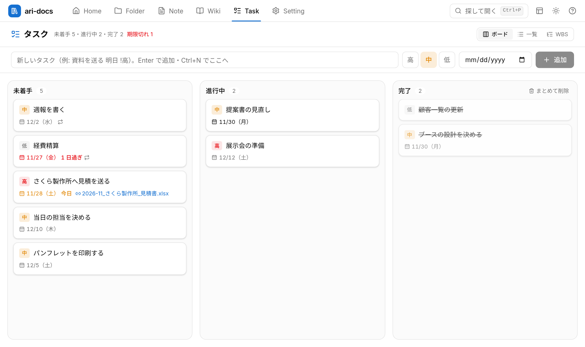

[ボード。カードをドラッグして進める]{.caption}
:::

| 表示 | 使い方 |
|---|---|
| ボード | 未着手・進行中・完了の 3 列。カードをドラッグして進めます |
| 一覧 | 期限・優先度などで並べ替えます。チェックで完了にします |
| WBS | 仕事を親子に分け、開始日と期限で日程の表（ガントチャート）を出します |

::: shot
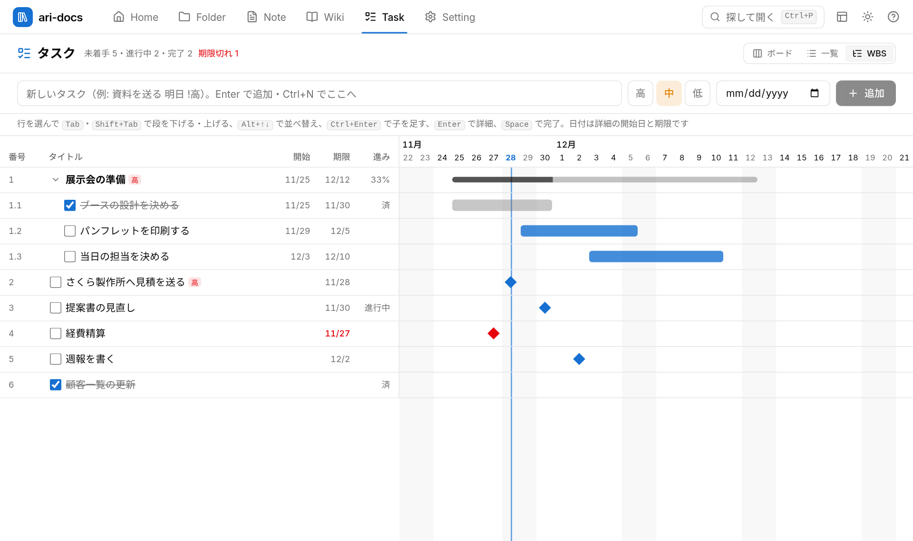

[WBS。仕事を分けて日程を立てる]{.caption}
:::

- カードを押すと詳細が開き、メモ・期限・繰り返しなどを変えられます。
- 繰り返し（毎日・平日・毎週・毎月）を選んだタスクは、完了にすると次の回が自動でできます。
- デスクトップアプリでは、期限が今日・過ぎたタスクを、起動したときと朝 8 時に通知でお知らせします（1 日 1 回。設定の「操作」で止められます）。
- Folder・Note・Wiki の右クリックの「タスクにする」で、そのファイル・文書へのリンク付きのタスクを作れます。

# 設定

右上の Setting（設定）で、自分の使い方に合わせて変えられます。

::: shot
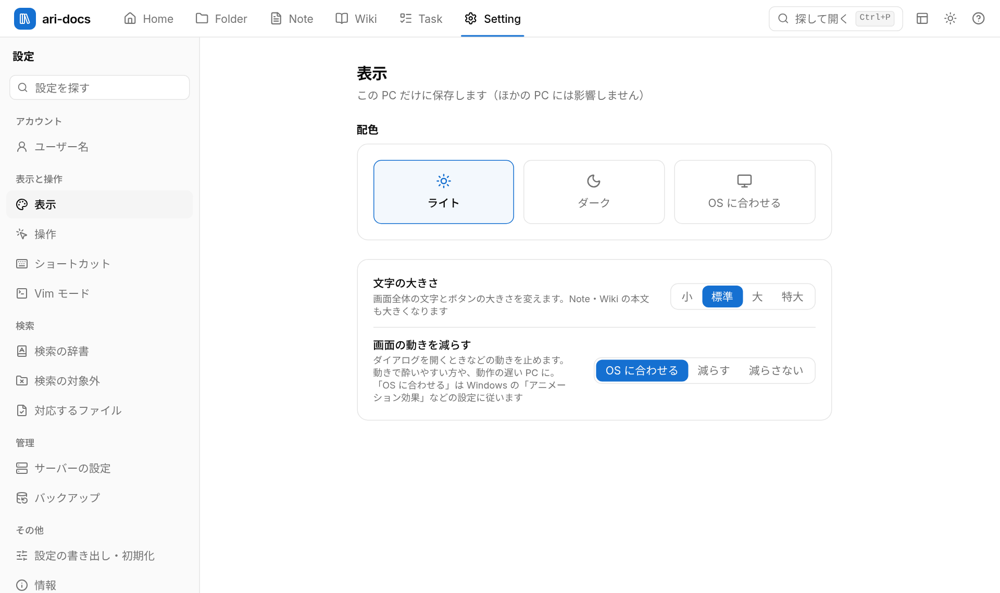

[設定の画面。左のメニューから選ぶ]{.caption}
:::

| メニュー | 変えられること |
|---|---|
| ユーザー名 | 画面に出す自分の名前 |
| パスワードとログイン | （共有サーバー）パスワードの変更、ログインしている PC の確認とログアウト |
| 表示 | 配色（明るい・暗い・OS に合わせる）・文字の大きさ・拡大・縮小 |
| 操作 | 起動したときに開く画面、削除の前に確かめる、右のプレビュー、タスクの通知など |
| ショートカット | キーの一覧と、キーの変更 |
| Vim モード | Vim のキーで操作する設定（使い慣れた方向け） |
| 検索の辞書・検索の対象外 | 検索の言葉の登録と、検索に出さないフォルダ |
| 場所 | 共有サーバーの登録 |

::: point
画面共有のときなどは、<kbd>Ctrl</kbd>+<kbd>+</kbd> で画面を大きく、<kbd>Ctrl</kbd>+<kbd>-</kbd> で小さく、<kbd>Ctrl</kbd>+<kbd>0</kbd> で元に戻せます（デスクトップアプリ）。100% 以外のときはヘッダーの右に倍率（例: 125%）が出て、押すと元に戻ります。
:::

設定（配色・文字の大きさなど）はこの PC に保存し、どの場所でも同じものを使います。

# 困ったとき

| こんなとき | 試すこと |
|---|---|
| 置いたファイルが検索で見つからない | 数分待ってから探します。設定の「検索の対象外」に入っていないかも確かめます |
| 消したファイルを戻したい | Folder の左下の「ゴミ箱」から元に戻します（既定で 30 日まで） |
| Note を前の内容に戻したい | 「変更履歴」のボタンから前の版に戻します |
| Excel を上書きしてしまった | ari-docs で上書きしたものなら、右クリックの「以前の版」から戻せます |
| 「〇〇さんがロックしています」と出る | ほかの人が編集中です。期限まで待つか、その人に外してもらいます |
| 共有サーバーにつながらない | ネットワークを確かめ、担当の方に連絡します。ヘッダーの「場所」で自分の PC に切り替えれば、個人用のデータは使えます |
| ログインできない（15 分間…と出る） | 時間をおいて試します。パスワードを忘れたら、管理者に再設定を頼みます |
| 文字が小さい・大きい | 設定の「表示」の「文字の大きさ」か、<kbd>Ctrl</kbd>+<kbd>+</kbd>・<kbd>Ctrl</kbd>+<kbd>-</kbd> |
| 新しい版のお知らせが出た | 「更新して再起動」を押します。作業中のものを保存してから押してください |

問い合わせるときは、設定の「情報」の「情報をコピー」で、アプリの版などの情報を写して伝えると早く解決できます。

# 付録: よく使うキー

| キー | 動き |
|---|---|
| <kbd>Ctrl</kbd>+<kbd>P</kbd> | 探して開く |
| <kbd>Alt</kbd>+<kbd>1</kbd>〜<kbd>6</kbd> | 画面の移動（Home・Folder・Note・Wiki・Task・Setting） |
| <kbd>?</kbd> | ショートカットの一覧 |
| <kbd>Ctrl</kbd>+<kbd>N</kbd> | 新しく作る（Note・Wiki・フォルダ）・タスクの欄へ |
| <kbd>Ctrl</kbd>+<kbd>S</kbd> | 保存 |
| <kbd>Ctrl</kbd>+<kbd>Shift</kbd>+<kbd>N</kbd> | 新しいウィンドウ |
| <kbd>Ctrl</kbd>+<kbd>+</kbd> / <kbd>Ctrl</kbd>+<kbd>-</kbd> / <kbd>Ctrl</kbd>+<kbd>0</kbd> | 拡大 / 縮小 / 元に戻す |
| <kbd>Space</kbd> | （Folder）プレビュー |
| <kbd>F2</kbd> | 名前の変更 |
| <kbd>Delete</kbd> | ゴミ箱へ（Folder）・削除 |
| <kbd>Ctrl</kbd>+<kbd>C</kbd> / <kbd>X</kbd> / <kbd>V</kbd> | コピー / 切り取り / 貼り付け（Folder） |
| <kbd>Ctrl</kbd>+<kbd>L</kbd> | 場所を打って移る（Folder） |
| <kbd>Alt</kbd>+<kbd>P</kbd> | 右のプレビューの出し入れ（Folder） |
| <kbd>Ctrl</kbd>+<kbd>Shift</kbd>+<kbd>C</kbd> | リンクをコピー（Folder） |

キーは設定の「ショートカット」で変えられます。
