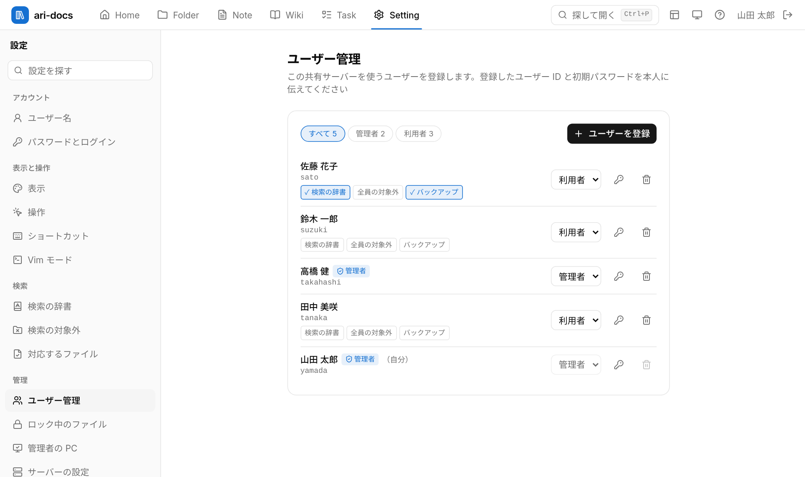
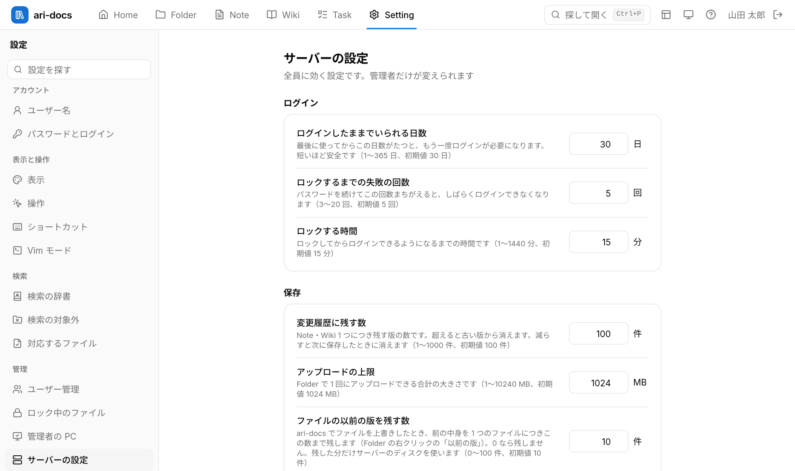
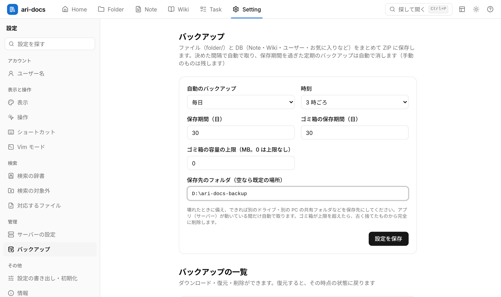

# この手引きについて

この手引きは、ari-docs を職場に入れる担当の方と、共有サーバーを管理する方のためのものです。毎日の使い方は「利用の手引き」をご覧ください。

## ari-docs の概要

| 項目 | 内容 |
|---|---|
| できること | ファイル（フォルダ）・Note（個人のメモ）・Wiki（共有の文書）・タスクを 1 つのアプリで扱い、ファイルの中身まで検索する |
| 形 | デスクトップアプリ（Windows・Linux）。共有サーバーは Linux のサーバーか、職場の Windows の PC で動かす |
| 料金 | 個人・会社とも無料（利用規約に従ってください） |
| 外への通信 | 個人用は PC の中だけで動きます。新しい版を調べるときだけ GitHub に問い合わせます（しない設定にもできます） |
| 外部のソフト | 要りません（データベースは中に入っています。文字認識も中に入っています） |

## 3 つの入れ方

| 入れ方 | 向いている場面 | 用意するもの |
|---|---|---|
| A. 個人用 | 1 人で使う。まず試す | 各自の PC だけ |
| B. 共有サーバー（Linux） | 部署・会社で使う。常に動かすサーバーがある | Linux のサーバー（社内のネットワーク） |
| C. この PC の公開 | 少人数で手軽に共有する。サーバー機が無い | 共有に使う Windows の PC（常に電源を入れておく） |

| | A. 個人用 | B. 共有サーバー（Linux） | C. この PC の公開 |
|---|---|---|---|
| データの置き場所 | 各自の PC | Linux のサーバー | 共有に使う PC |
| 利用者の PC | アプリだけで完結 | アプリからサーバーにつなぐ | アプリから共有に使う PC につなぐ |
| ログイン | なし | あり | あり |
| 常に動かしておくもの | なし | サーバー | 共有に使う PC のアプリ |
| 通信 | PC の中だけ | HTTP か HTTPS | HTTP（社内のネットワークだけ） |

::: point
迷ったら、まず A（個人用）で試し、良さそうなら B か C に進むのがおすすめです。個人用のデータは、あとから共有サーバーに移せます（ファイルを共有サーバーの Folder にアップロードする）。
:::

# 動作環境と規模

## 動作環境

| 対象 | 環境 |
|---|---|
| 利用者の PC（Windows） | Windows 10・11（64 ビット）。画面の表示に Microsoft Edge WebView2 を使います（Windows 10・11 には入っています） |
| 利用者の PC（Linux） | 64 ビットの Linux（AppImage） |
| 共有サーバー（B） | 64 ビットの Linux。Ubuntu 24.04・Debian 13 と同じくらい新しいもの（glibc 2.39 以降） |
| 共有に使う PC（C） | 利用者の PC と同じ（Windows 10・11） |
| ネットワーク | 共有サーバーは社内のネットワークで使います。待ち受けのポートは既定で 8080 番 |

## 規模の目安

| 項目 | 目安 |
|---|---|
| 人数 | 共有サーバー 1 台で 20 人程度まで |
| ファイルの数 | 1 万ファイル程度まで（1 万ファイルで、検索は 0.1 秒未満） |
| 1 回のアップロード | 既定 1 GB まで（設定で 10 GB まで） |
| 中身の検索 | 1 ファイル 100 MB まで |

この規模を超えるときは、試しに使ってみて速さを確かめてください。

## ディスクの使い方

| データ | 大きさの目安 |
|---|---|
| ファイル（Folder） | 置いたファイルの合計 |
| データベース | 検索の索引・Note・Wiki・画像。ファイルの合計の数％〜1 割程度 |
| ゴミ箱 | 消したファイル（既定 30 日で消える。容量の上限も決められる） |
| 以前の版 | 上書きしたファイルの前の中身（1 ファイルにつき既定 10 版） |
| バックアップ | 取るたびに、データベースとファイルの合計の ZIP |

# 利用者の PC に入れる

## 配布物を取ってくる

配布物は次の場所に載っています。

`https://github.com/NaoyaYokoyama/ari-docs-releases/releases`

| ファイル | 内容 |
|---|---|
| `ari-docs_user-guide_<版>.pdf` | 説明書「利用の手引き」（この版のもの） |
| `ari-docs_admin-guide_<版>.pdf` | 説明書「導入と運用の手引き」（この版のもの。この文書） |
| `ari-docs_<版>_x64-setup.exe` | Windows のインストーラー |
| `ari-docs_<版>_amd64.AppImage` | Linux のアプリ |
| `ari-docs-server_<版>_linux-x86_64.tar.gz` | Linux の共有サーバー一式（説明書の PDF も `manual/` に入っています） |
| `….sig`・`latest.json` | 更新のための署名と案内（アプリが使います） |

::: warning
インストーラーにはまだコード署名がありません。Windows で開くと「Windows によって PC が保護されました」と出るので、「詳細情報」→「実行」で進めてください。配るときは、社内の決まった場所（共有フォルダなど）に置いて取ってもらい、メールの添付などで回さないでください。
:::

## インストーラーの流れ

1. インストーラーを開き、利用規約に同意します。
2. 使い方を選びます。
   - 「個人用（この PC だけで使う）」
   - 「共有サーバーに接続する」と、サーバーの URL（例: `http://ari-server:8080`）。インストーラーがサーバーにつながるかを確かめます（つながらなくても、そのまま進めることもできます）。
3. インストールが終わったら起動します。

| 項目 | 内容 |
|---|---|
| 入る場所 | ユーザーごと（`%LOCALAPPDATA%\ari-docs`）。管理者の権限は要りません |
| 個人用のデータの場所 | 入れたフォルダの `folder`（ファイル）と `.ari-docs`（データベースなど）。設定の「作業フォルダ」で変えられます |
| 共有サーバーの追加 | あとから設定の「場所」で、5 つまで登録できます |

::: note
入れたあとでも、設定の「場所」で共有サーバーを足したり、自分の PC と切り替えたりできます。
:::

# 共有サーバーを作る（Linux）

常に動かす Linux のサーバーで共有サーバーを動かす方法です。サーバーに画面は要りません。

## 置く

1. 配布物から `ari-docs-server_<版>_linux-x86_64.tar.gz` を取ってきます。
2. 置き場所を作って展開します（例: `/opt/ari-docs/`）。動かす利用者がこのフォルダに書き込めるようにします（画面からの更新で中身を入れ替えるため）。

```bash
sudo useradd --system --home /opt/ari-docs ari-docs
sudo mkdir -p /opt/ari-docs/folder
sudo tar -xzf ari-docs-server_<版>_linux-x86_64.tar.gz -C /opt/ari-docs
sudo chown -R ari-docs: /opt/ari-docs
```

3. 設定ファイル `/opt/ari-docs/config.toml` を書きます。

```toml
mode = "shared"
bind_address = "0.0.0.0"   # 待ち受けるアドレス（特定の NIC だけならその IP）
port = 8080
folder_root = "folder"     # ファイルの置き場所（設定ファイルからの相対パス）
database_path = "ari.db"   # データベース（このフォルダがデータのフォルダになる）
docs_default_root = "folder"
# HTTPS にするとき（PEM 形式の証明書と秘密鍵）
# tls_cert = "cert.pem"
# tls_key = "key.pem"
```

::: warning
`folder_root` は運用を始めたあとは変えないでください。お気に入りなどが、この場所からの相対パスで記録されています。
:::

## サービスとして動かす

`/etc/systemd/system/ari-docs.service` を作り、登録します。

```ini
[Unit]
Description=ari-docs 共有サーバー
After=network-online.target
Wants=network-online.target

[Service]
User=ari-docs
WorkingDirectory=/opt/ari-docs
ExecStart=/opt/ari-docs/back /opt/ari-docs/config.toml
Restart=on-failure
RestartSec=5

[Install]
WantedBy=multi-user.target
```

```bash
sudo systemctl enable --now ari-docs   # 登録して起動
sudo systemctl status ari-docs         # 動いているか
journalctl -u ari-docs                 # 起動したときの表示・ログ
```

ファイアウォールでは、社内のネットワークからだけ待ち受けのポート（8080）を開けてください。

## 最初の管理者を登録する

1. 起動したときの表示（`journalctl -u ari-docs`）か、データのフォルダの `setup-code.txt` にある「最初の管理者の登録コード」（`XXXX-XXXX`）を控えます。
2. 管理者が自分の PC のアプリで、共有サーバーの URL（`http://<サーバー名>:8080`）につなぎます。
3. ログインの画面で、登録コードと、管理者のユーザー ID・表示名・パスワードを入れて登録します。

登録に使った PC が「管理者の PC」になります（あとで説明します）。コードを知らない人は管理者を登録できません。

## HTTPS にする

社内の認証局などで発行した証明書を `tls_cert`・`tls_key` に書くと HTTPS になります。URL は `https://<サーバー名>:8080` にします。利用者の PC がその証明書（認証局）を信頼している必要があります（自己署名の証明書のままではつながりません）。

::: warning
nginx などのリバースプロキシの後ろには置かないでください。すべての接続がサーバーの中からに見え、最初の管理者の登録コードを求めなくなるためです。
:::

## 動いているかを確かめる

利用者の PC から次を実行して、`"mode":"shared"` が返れば動いています。

```bash
curl http://<サーバー名>:8080/api/server-info
```

# 共有サーバーを作る（この PC の公開）

サーバー機が無いときは、職場の Windows の PC（常に電源を入れておくもの）に ari-docs を入れ、その PC をそのまま共有サーバーにできます。

1. 共有に使う PC に ari-docs を個人用で入れます。
2. 設定の「この PC の公開」を開き、最初の管理者のユーザー ID・表示名・パスワードを決めて公開します。今のデータ（個人用のもの）は、その管理者のものになります。
3. アプリが再起動し、ほかの PC から `http://<この PC の名前か IP>:8080` でつなげるようになります。
4. Windows のファイアウォールの確認が出たら、「プライベート ネットワーク」だけを許可します。

| 項目 | 内容 |
|---|---|
| ポート | 既定 8080。設定の「この PC の公開」で変えられます |
| 通信 | HTTP（社内のネットワークだけで使ってください） |
| 動いている間 | 共有に使う PC で ari-docs のアプリを開いている間だけ使えます |
| 公開をやめる | 「公開」をオフにすると、ほかの PC からつながらなくなります（データとログインはそのまま） |

::: note
共有に使う PC の中でも、ファイルはほかの PC と同じく、取ってきてから開きます。
:::

# 利用者の PC をつなぐ

利用者には、次のどちらかでつないでもらいます。

- インストーラーで「共有サーバーに接続する」を選び、URL を入れる
- 入れ済みのアプリの設定の「場所」で共有サーバーを足す

管理者は、設定の「ユーザー管理」で利用者を登録し、ユーザー ID と初めのパスワードを本人に伝えます。

# ユーザーと権限

## 管理者と利用者

| できること | 利用者 | 管理者 |
|---|---|---|
| ファイル・Wiki を見る・作る・直す・消す | ○ | ○ |
| 自分の Note・タスク | ○（本人だけ） | ○（本人だけ） |
| ユーザーの登録・削除・パスワードの再設定 | - | ○ |
| サーバーの設定 | - | ○ |
| バックアップの設定・作成 | 許可を付けた人 | ○ |
| バックアップのダウンロード・復元・削除 | - | ○ |
| 検索の辞書の登録 | 許可を付けた人 | ○ |
| 全員の検索の対象外の登録 | 許可を付けた人 | ○ |
| ほかの人のファイルのロックを外す | - | ○ |

::: shot


[ユーザー管理。許可は一覧のボタンで付ける]{.caption}
:::

- 管理者はほかの人を管理者・利用者に切り替えられます（自分は変えられません）。
- ユーザーを消すと、その人の Note・お気に入り・設定・タスクも消えます。Wiki とファイルは残ります。
- 共有サーバーの Folder のファイルは、ログインした全員が見られます。フォルダごとに見られる人を分ける仕組みはありません。人によって見せたくないファイルは、共有サーバーに置かないでください。

## 管理者の PC

管理者の操作（ユーザー管理・サーバーの設定・バックアップなど）は、登録した PC（管理者の PC）からだけできます。ほかの PC で管理者がログインしても、利用者として扱います。パスワードが漏れても、ほかの PC から管理の操作をされないための仕組みです。

| したいこと | 手順 |
|---|---|
| 管理者の PC を足す | 登録済みの PC の設定の「管理者の PC」でコード（10 分有効）を発行し、足したい PC の設定の「管理者の PC」で入れる |
| 管理者の PC をすべて失った | サーバーを起動し直すと、登録用のコードが起動の表示と `setup-code.txt` に出る。それを「管理者の PC」に入れる |
| 管理者がパスワードを忘れた | ほかの管理者が再設定する |

# サーバーの設定

管理者は、設定の「サーバーの設定」で次のものを変えられます。保存するとすぐ効きます（再起動は要りません）。

::: shot


[サーバーの設定。それぞれに範囲と既定の値が出る]{.caption}
:::

| 設定 | 範囲 | 既定 |
|---|---|---|
| ログインしたままでいられる日数 | 1〜365 日 | 30 日 |
| ロックするまでのログインの失敗の回数 | 3〜20 回 | 5 回 |
| ログインをロックする時間 | 1〜1440 分 | 15 分 |
| Note・Wiki の変更履歴に残す数 | 1〜1000 件 | 100 件 |
| アップロードの上限 | 1〜10240 MB | 1024 MB |
| ファイルの以前の版を残す数 | 0〜100 件 | 10 件 |
| ファイルのロックの期限の上限 | 1〜365 日 | 7 日 |
| 画像を縮める | オン・オフ | オン |
| 画像の画質 | 10〜100% | 85%（70% 未満で注意が出ます） |
| 画像の長い辺の上限 | 800〜4096 画素 | 1920 画素（1280 未満で注意が出ます） |
| Wiki を書いている間はロックする | オン・オフ | オン |
| Docs（Markdown ビューア）を使う | オン・オフ | オフ |

- 画像の設定は、Note・Wiki に貼る画像と、Docs が送る画像に使います（Docs の元のファイルは変えません）。すでに貼った画像は変わりません。
- Wiki のロックをオンにすると、だれかが書いている間、ほかの人は読むだけになります（止まって 10 分で自動で外れます。管理者は Wiki の画面の「ロックを外す」で外せます）。

# バックアップと復元

## 自動のバックアップ

設定の「バックアップ」で、自動のバックアップを決めます。データベースの写しとファイル（`folder`）を 1 つの ZIP にします。

::: shot


[バックアップ。自動の間隔・保存期間・保存先を決める]{.caption}
:::

| 設定 | 内容 |
|---|---|
| 自動のバックアップ | しない・毎日・毎週（月曜）・毎月（1 日） |
| 時刻 | 取る時刻（その時刻を過ぎて最初の 1 回） |
| 保存期間 | 過ぎた自動のバックアップを消す日数（手動のものは消さない） |
| 保存先 | 空なら既定の場所（データのフォルダの `backups`）。**サーバーの故障に備えて、別のディスクか別の PC の共有フォルダにしてください** |
| ゴミ箱の保存期間・容量の上限 | ゴミ箱のものを自動で消す日数と、容量の上限（0 は上限なし） |

「今すぐバックアップ」で手動でも取れます。自動のバックアップに失敗すると、この画面に日時と理由が出ます。

::: warning
ゴミ箱の中身と、ファイルの以前の版はバックアップに入りません。
:::

## 復元する

1. 「バックアップ」の一覧で、戻したい時点の「この時点に戻す」を押します。
2. 今の状態が「復元の前」のバックアップとして自動で残ります。間違えたときは、それを復元し直します。
3. 復元の間は、ほかの人の操作が失敗することがあります。使う人の少ない時間に行ってください。

復元しても、サーバーの設定・バックアップの設定と一覧・ゴミ箱は今のものを残します。

## 別のサーバーへ移す

1. 「ダウンロード」でバックアップの ZIP を保存します。
2. 移す先で ari-docs を止めてから、ZIP の中の `folder` の中身を新しいファイルの置き場所に、`ari.db` をデータベースの場所に置きます。
3. 起動します。

# 更新

## 新しい版の出し方

新しい版は、配布物の場所（`ari-docs-releases`）に載ります。GitHub のリポジトリの「Watch → Custom → Releases」をオンにすると、新しい版が出たときに知らせが届きます。

## 共有サーバーを更新する

1. 管理者の PC で、設定の「情報」の「サーバーの更新」から「サーバーを更新」を押します。
2. サーバーが新しい版を取ってきて署名を確かめ、入れ替えて起動し直します（数十秒。その間は使っている人の操作が切れます）。
3. 利用者のアプリは、次にログインしたときなどに、サーバーと同じ版への更新を勧めます（サーバーより新しい版にはしません）。

::: note
更新の前の版（`back.old`）と、更新の前のデータベースの写し（データのフォルダの `server-update/`）が残ります。更新したあとに起動しないときは、これに戻せます。この PC の公開で動かしているサーバーは、アプリの更新と一緒に上がります。
:::

## インターネットにつながらない環境

| 対象 | 手順 |
|---|---|
| 共有サーバー | 管理者の PC で `ari-docs-server_<版>_linux-x86_64.tar.gz` と `.sig` を取ってきて、「サーバーの更新」の「ファイルから更新」で上げる |
| 利用者のアプリ | アプリの配布物（`…x64-setup.exe` と `.sig` など。名前は変えない）を、サーバーのデータのフォルダの `app-update/` に置く。アプリはサーバーからそれを取って更新する |

署名を確かめるので、改ざんされた配布物は入りません。

## 個人用のアプリの更新

個人用のアプリは、初めて起動したときに「起動したときに新しい版を調べるか」を聞きます。調べない設定にしたときは、設定の「情報」の「更新を確認」を押したときだけ調べます。

# セキュリティ

## 守りの仕組み

| 項目 | 内容 |
|---|---|
| ログイン | ユーザー ID とパスワード（パスワードは復元できない形（Argon2）で保存）。続けて間違えると一定時間ロック |
| 管理の操作 | 登録した管理者の PC からだけ |
| 個人用 | この PC の中（`127.0.0.1`）だけで待ち受け、ほかの PC からはつながりません |
| 通信 | 共有サーバーは設定で HTTPS にできます。この PC の公開は HTTP（社内のネットワークだけで使ってください） |
| 本文に書かれたもの | Note・Wiki に書かれた HTML は安全なものだけに絞り、プログラムは動かしません |
| ファイル | `folder` の外のファイルは扱いません。共有サーバーの実行するファイル（`.exe` など）はアプリから直接は開きません |
| データベース | 利用者が入れた文字（タイトル・本文・ファイル名・検索語など）を命令として扱わない作り（SQL インジェクション対策） |
| 更新 | 配布物の署名を確かめてから入れ替えます |

## データの置き場所

| データ | 個人用（Windows） | 共有サーバー（B の例） |
|---|---|---|
| ファイル | `%LOCALAPPDATA%\ari-docs\folder` | `/opt/ari-docs/folder` |
| データベース | `%LOCALAPPDATA%\ari-docs\.ari-docs\ari.db` | `/opt/ari-docs/ari.db` |
| ゴミ箱・以前の版・ログ | `.ari-docs` の中の `trash`・`versions`・`logs` | `/opt/ari-docs/` の中の `trash`・`versions`・`logs` |
| 個人の設定（配色など） | アプリのフォルダの `preferences.json` | （各利用者の PC） |

保存しているデータは暗号化していません。PC・サーバーのディスクの暗号化（BitLocker など）と、フォルダの権限で守ってください。

## ログ

エラーはデータのフォルダの `logs/error.log` に残ります（1 MB × 5 個まで。古いものから消えます）。共有サーバーでは `journalctl -u ari-docs` でも見られます。問い合わせのときは、設定の「情報」の「情報をコピー」と、このログを添えてください。

# 困ったとき

| こんなとき | 原因 | 対処 |
|---|---|---|
| アプリで「サーバーにつながらない」 | サーバーが止まっている・ファイアウォール・URL の誤り | サーバーで `systemctl status ari-docs`、利用者の PC から `curl http://<サーバー名>:8080/api/server-info` |
| 「このサーバーは共有モードで動いていません」 | `config.toml` の `mode` が `local` | `mode = "shared"` にして起動し直す |
| 起動の表示に「ポート 8080 を使えません」 | ほかのアプリが使っている | `port` を変え、利用者の URL も合わせる |
| HTTPS にしたらつながらない | 利用者の PC が証明書を信頼していない | 証明書（認証局）を利用者の PC に入れる |
| 「15 分間ログインできません」 | 続けて間違えた | 時間をおく。パスワードは管理者が再設定する |
| 管理者なのに管理の画面が出ない | 管理者の PC に登録していない | 「管理者の PC」で登録する |
| サーバーの更新で「GitHub で新しい版を調べられません」 | サーバーがインターネットにつながらない | 「ファイルから更新」を使う |
| 「新しい版がこのサーバーで動きません」 | Linux が古い（glibc 2.39 より前） | Linux を新しくする |
| 個人用のアプリで「ari-docs はもう起動しています」 | 同じ PC で 2 つ起動しようとした | 動いている方を使う |

# 利用規約と問い合わせ

- ari-docs は個人・会社とも無料で使えるフリーソフトです。改変・組織の外への再配布・販売はできません。くわしくは、インストーラーとアプリの設定の「クレジット」にある利用規約をご覧ください。
- 使っている部品（オープンソースのソフトウェア）のライセンスは、設定の「クレジット」と、配布物の `THIRD_PARTY_NOTICES.txt` にあります。
- 不具合の報告・要望は、配布物の場所（`ari-docs-releases`）の案内に従ってください。
